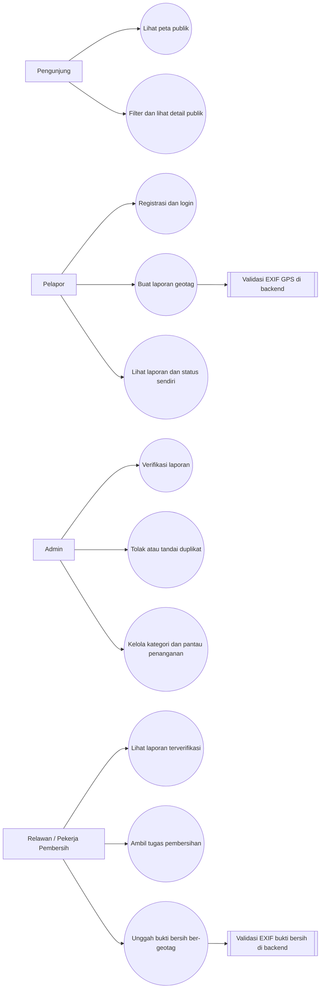
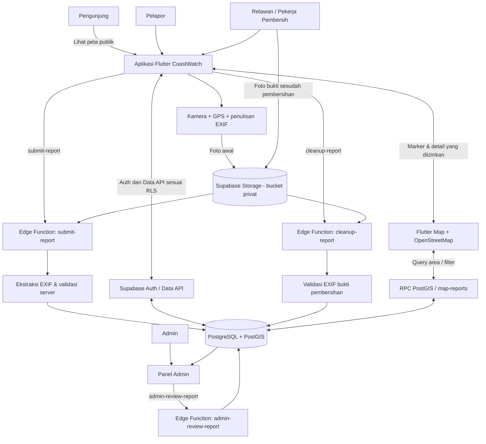
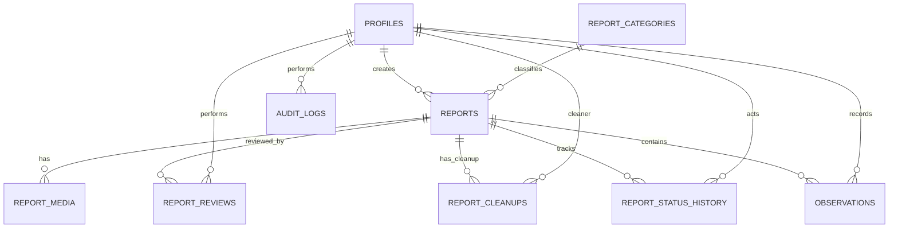

# DESAIN SISTEM COASTWATCH

**Nama sistem:** CoastWatch  
**Tema:** Aplikasi Pelaporan Lingkungan Pesisir dan *Citizen Science* Berbasis Geotagging  
**Platform utama:** Aplikasi mobile Flutter (fokus implementasi awal: Android)  
**Stack yang dipilih:** Flutter/Dart, Supabase Free, PostgreSQL + PostGIS, Supabase Storage, Supabase Auth, Supabase Edge Functions (TypeScript/Deno), Flutter Map, dan OpenStreetMap.  
**Komponen inti:** Kamera, koordinat GPS dalam metadata foto (EXIF), validasi server-side, Supabase Data API/Edge Functions, PostgreSQL/PostGIS, Supabase Storage, dan GIS/peta interaktif.

---

## 1. Gambaran Umum

### 1.1 Latar Belakang

CoastWatch adalah aplikasi mobile yang membantu masyarakat mendokumentasikan dan melaporkan masalah lingkungan pesisir, khususnya sampah dan limbah yang ditemukan di pantai, muara, kawasan mangrove, pelabuhan, serta area pesisir lainnya. Laporan dilengkapi foto sebagai bukti visual dan koordinat lokasi yang dibaca dari metadata geospasial foto.

Laporan dikirim melalui API ke server, divalidasi, disimpan pada Supabase PostgreSQL, dan ditampilkan pada peta GIS setelah memenuhi aturan publikasi. Sistem melibatkan empat aktor sesuai proposal: Pengunjung, Pelapor, Admin, dan Relawan/Pekerja Pembersih Sampah. Admin memverifikasi bukti digital, sedangkan Relawan dapat mengambil laporan terverifikasi sebagai tugas pembersihan dan mengunggah foto bukti sesudah pembersihan yang juga harus memiliki geotag valid.

### 1.2 Tujuan Sistem

1. Memudahkan masyarakat melaporkan sampah, limbah, dan indikasi masalah lingkungan pesisir dengan bukti foto dan lokasi yang tergeotag.
2. Mengurangi laporan yang tidak memiliki lokasi yang jelas melalui pembacaan koordinat dari metadata foto.
3. Menyediakan peta publik untuk laporan terverifikasi yang dapat difilter berdasarkan kategori dan waktu; status penanganan ditampilkan pada detail/tugas yang sesuai hak akses.
4. Menyediakan proses verifikasi serta pelacakan status laporan secara transparan.
5. Mengumpulkan data partisipatif yang dapat digunakan untuk memahami pola masalah lingkungan pesisir dari waktu ke waktu.
6. Menyediakan data yang terstruktur agar dapat ditinjau Admin dan digunakan sebagai catatan partisipatif untuk memahami masalah lingkungan pesisir.
7. Mendukung tindak lanjut laporan melalui Relawan/Pekerja Pembersih dan menyimpan foto bukti sesudah pembersihan yang ber-geotag.

### 1.3 Prinsip Desain

- **Geotagging adalah bagian inti:** koordinat laporan bersumber dari tag GPS pada metadata EXIF foto, bukan sekadar lokasi yang dipilih manual di peta.
- **Foto adalah bukti utama:** deskripsi pengguna melengkapi foto, bukan menggantikan bukti visual. Bukti awal dan bukti setelah pembersihan disimpan sebagai media yang berbeda.
- **Lokasi dan waktu perlu diperiksa:** metadata membantu menentukan lokasi dan waktu, tetapi tidak otomatis membuktikan bahwa foto asli, baru, atau tidak dimanipulasi.
- **Laporan belum tentu terverifikasi:** laporan baru harus dibedakan secara jelas dari laporan yang sudah diperiksa Admin. Laporan terverifikasi pun belum berarti sudah dibersihkan.
- **GIS membantu pemahaman, bukan menetapkan kebenaran:** peta menampilkan pola laporan dan tidak boleh langsung ditafsirkan sebagai bukti final tingkat pencemaran.
- **Privasi seperlunya:** identitas pelapor tidak ditampilkan kepada publik; metadata foto yang tidak relevan tidak dibuka kepada pengguna umum.
- **Tindak lanjut tercatat:** jika Relawan melakukan pembersihan, foto bukti setelah pembersihan beserta koordinat EXIF-nya diproses dan dihubungkan dengan laporan awal.
- **Guest sebagai keadaan awal:** aplikasi mobile dapat dibuka tanpa login untuk melihat Beranda dan Peta Publik; autentikasi diminta ketika pengguna mencoba mengirim laporan atau mengakses data personal.
- **Tetap sesuai tema:** CoastWatch berfokus pada pelaporan lingkungan pesisir, pengelolaan bukti geotag, peta, verifikasi, tindak lanjut pembersihan, dan pengumpulan data citizen science. Sistem tidak dirancang sebagai marketplace, sistem pengaduan semua jenis masalah, atau perangkat pemantauan sensor laut otomatis.

---

## 2. Teknologi yang Digunakan

Teknologi berikut ditetapkan sebagai stack implementasi CoastWatch versi tugas kuliah. Pemilihan ini mengutamakan integrasi yang sederhana dan penggunaan paket gratis, dengan ruang lingkup yang sesuai untuk prototipe. Batas paket dan kebijakan penyedia dapat berubah, sehingga kuota harus diperiksa kembali saat proyek dibuat.

| Komponen | Teknologi pilihan | Fungsi dalam CoastWatch |
|---|---|---|
| Aplikasi mobile | **Flutter + Dart** | Membuat antarmuka Android; iOS tidak wajib untuk target MVP. |
| Panel Admin web | **Flutter Web** | Konsol desktop terpisah untuk antrean verifikasi, kategori, pemantauan penanganan, dan audit; tidak dicampur ke navigasi mobile. |
| Kamera dan lokasi | Plugin kamera Flutter + `geolocator` | Mengambil foto dan memperoleh lokasi perangkat beserta akurasi lokasi jika tersedia. |
| Penulisan/pembacaan EXIF di perangkat | Pustaka EXIF yang kompatibel dengan Flutter; `camera_with_gps` dapat dievaluasi sebagai opsi | Menambahkan tag GPS saat foto dibuat dan memeriksa apakah koordinat berhasil tersimpan. Paket yang dipilih harus diuji pada perangkat Android target. |
| Pembacaan EXIF di backend | Pustaka pembaca EXIF yang kompatibel dengan Deno/TypeScript | Mengekstrak ulang GPS dari foto di server; hasil server menjadi sumber koordinat resmi. |
| Autentikasi | **Supabase Auth** | Registrasi, login, sesi pengguna, dan identitas akun. |
| Cloud database | **Supabase PostgreSQL** | Menyimpan profil, laporan, kategori, status, riwayat pemeriksaan, dan audit. |
| GIS database | **PostGIS** pada PostgreSQL | Menyimpan/mencari geometri lokasi dan menjalankan query berdasarkan area peta bila diperlukan. |
| Object storage | **Supabase Storage** | Menyimpan foto asli pada bucket privat dan foto turunan yang aman untuk ditampilkan. |
| API dan logika server | **Supabase Data API + Edge Functions** | Data API menangani operasi data yang diizinkan; Edge Functions menangani alur yang memerlukan validasi server-side. |
| Peta mobile | **Flutter Map** | Merender basemap, marker laporan, cluster, dan interaksi peta. |
| Basemap | **OpenStreetMap** | Menyediakan data peta dasar dengan atribusi yang jelas. Penggunaan server tile publik wajib mengikuti kebijakan tile dan bukan layanan tanpa batas. |
| Peralatan pengembangan | Android Studio atau VS Code, Git | Menulis kode, menjalankan aplikasi, menguji, dan melacak perubahan kode. |

### 2.1 Ketentuan Paket Gratis

- Gunakan proyek **Supabase Free** dan jangan meningkatkan ke paket berbayar atau mengaktifkan add-on berbayar untuk kebutuhan MVP.
- Kuota acuan yang digunakan pada rancangan ini mengikuti paket Supabase Free yang dicantumkan dalam proposal: database 500 MB per proyek, object storage 1 GB, egress 5 GB, dan hingga 500.000 pemanggilan Edge Functions. Angka dan kebijakan dapat berubah; cek kembali halaman harga resmi sebelum implementasi.
- Batasi ukuran foto, misalnya maksimum 5 MB per foto pada MVP, kompres foto untuk tampilan, dan simpan hanya data yang diperlukan agar kuota cukup untuk demo.
- Proyek gratis dapat memiliki batas pemakaian dan kebijakan jeda ketika tidak aktif. Biaya Rp0 ditargetkan dengan tetap berada dalam paket gratis; jangan menganggap kuota atau ketersediaan layanan tidak terbatas.
- Untuk OpenStreetMap, bedakan data peta yang terbuka dari server tile publik yang memiliki kapasitas terbatas. Cantumkan atribusi dan jangan melakukan prefetch atau unduhan tile massal.

### 2.2 Teknologi yang Tidak Digunakan pada MVP

Firebase Storage/Cloud Functions, server VPS khusus, layanan peta berbayar, AI untuk klasifikasi limbah, sistem IoT, serta layanan notifikasi berbayar tidak diperlukan untuk alur MVP. Penghindaran komponen tersebut menjaga implementasi tetap terarah dan mengurangi risiko penggunaan layanan berbayar.

---

## 3. Teknologi Backend / API

CoastWatch menggunakan backend terkelola Supabase. Untuk operasi CRUD sederhana, aplikasi memanfaatkan Supabase Flutter SDK dan Data API yang dihasilkan dari PostgreSQL, dengan Row Level Security (RLS) sebagai pembatas akses data. Backend server kustom hanya dibuat untuk alur yang benar-benar membutuhkan kepercayaan server.

### 3.1 Pembagian Tanggung Jawab

| Bagian | Implementasi | Tanggung jawab |
|---|---|---|
| Autentikasi | Supabase Auth melalui Flutter SDK | Registrasi, login, logout, sesi pengguna, dan identitas pengirim permintaan. |
| CRUD laporan, kategori, dan tugas | Supabase Flutter SDK / Data API | Membaca data sesuai izin, melihat riwayat sendiri, membaca kategori aktif, dan memuat daftar tugas yang hak aksesnya diizinkan. |
| Unggah foto | Supabase Storage melalui SDK | Menyimpan foto pada bucket privat dengan kebijakan akses yang membatasi unggahan ke direktori milik pengguna. |
| Pengajuan laporan | Edge Function `submit-report` | Memastikan pengguna terautentikasi, memeriksa objek foto, membaca ulang EXIF, memvalidasi koordinat, dan membuat laporan. |
| Pemeriksaan laporan | Edge Function `admin-review-report` | Memastikan pemanggil berperan sebagai Admin, merekam keputusan dan alasan, lalu mengubah status melalui aturan transisi yang sah. |
| Tugas dan bukti pembersihan | Edge Function `cleanup-report` | Memastikan pemanggil berperan sebagai Relawan, memvalidasi pengambilan tugas, mengekstrak ulang GPS EXIF foto sesudah pembersihan, mencatat bukti, dan mengubah status sesuai aturan. |
| Query marker peta | Fungsi SQL/RPC dengan PostGIS atau Edge Function `map-reports` | Mengembalikan marker berdasarkan area (`bbox`), kategori, tanggal, dan batas hasil; pada peta publik hanya status `verified` yang diperbolehkan. Filter status untuk data privat mengikuti role dan izin akses. |
| Kebijakan keamanan data | PostgreSQL RLS, Storage policies, validasi fungsi | Mencegah pengguna membaca atau mengubah laporan pengguna lain tanpa izin. |

### 3.2 Alur Pengajuan Laporan melalui Backend

1. Pengguna login melalui Supabase Auth.
2. Aplikasi mengambil foto, menambahkan koordinat GPS ke EXIF, dan melakukan pemeriksaan awal.
3. Aplikasi mengunggah foto ke bucket privat, misalnya `report-originals`, di bawah path yang terkait dengan ID pengguna.
4. Aplikasi memanggil Edge Function `submit-report` dan mengirim path objek beserta kategori dan deskripsi. Koordinat dari formulir/klien tidak dijadikan sumber final.
5. Edge Function memverifikasi sesi pengguna, memeriksa bahwa objek foto memang terkait dengan pengguna tersebut, mengunduh foto dari Storage, dan mengekstrak GPS dari EXIF di sisi server.
6. Function memvalidasi format, ukuran, koordinat, dan kelengkapan data. Jika valid, function menyimpan `latitude` dan `longitude` yang berasal dari ekstraksi server serta menetapkan status awal `pending_review`.
7. Jika foto tidak memiliki GPS EXIF valid, laporan tidak dibuat dan aplikasi menerima kode kesalahan yang dapat dijelaskan kepada pengguna.
8. Foto asli tetap privat. Foto untuk tampilan publik harus dibuat sebagai turunan yang tidak membawa metadata pribadi yang tidak dibutuhkan; file asli tidak boleh dibuka kepada publik hanya karena suatu laporan tampil di peta.
9. Foto turunan publik untuk bukti awal baru disediakan setelah Admin memverifikasi laporan. Foto bukti pembersihan diproses sebagai media `after` dan dihubungkan dengan tugas pembersihan yang bersangkutan.

### 3.3 Alur Backend untuk Tugas dan Bukti Pembersihan

1. Relawan terautentikasi meminta daftar laporan yang statusnya `verified` dan belum diklaim.
2. Saat Relawan memilih **Ambil Tugas**, backend memvalidasi role `cleaner`, status laporan, dan ketersediaan tugas. Perubahan penugasan dilakukan secara atomik agar tugas tidak diklaim oleh dua Relawan sekaligus.
3. Backend membuat record `report_cleanups` dengan `cleaner_id`, `started_at`, dan status tugas `in_progress`, lalu mengubah status laporan menjadi `in_progress`.
4. Relawan mengunggah foto sesudah pembersihan ke path privat yang terikat ke akun dan laporan, lalu memanggil `cleanup-report` dengan aksi `complete`.
5. Edge Function mengambil foto dari Storage, memvalidasi format dan ukuran maksimal 5 MB, membaca GPS EXIF di server, serta memeriksa bahwa Relawan adalah pemegang tugas tersebut.
6. Jika bukti valid, backend memperbarui record tugas pembersihan yang sudah dibuat ketika Relawan mengambil tugas, menyimpan koordinat dan waktu foto pembersihan pada data media/tugas yang terpisah dari koordinat laporan awal, mengisi `completed_at`, lalu mengubah status laporan ke `cleaned`. Jika tidak valid, status tetap `in_progress` dan API mengembalikan alasan kegagalan.
7. Admin dapat memantau bukti awal dan bukti sesudah pembersihan melalui panel terproteksi. Foto asli tetap privat; hanya turunan yang telah dibersihkan dari metadata pribadi yang boleh ditampilkan kepada publik sesuai kebijakan.

### 3.4 Aturan Keamanan Backend/API

- `SUPABASE_URL` dan publishable/anon key dapat digunakan pada aplikasi sesuai pedoman Supabase, tetapi **service-role key, secret key, password database, dan secret lain tidak boleh dimasukkan ke aplikasi mobile**.
- Operasi yang menggunakan hak istimewa dilakukan di Edge Functions dengan secret yang disimpan pada pengaturan secrets server, bukan di repositori atau kode aplikasi.
- Terapkan RLS pada seluruh tabel yang dapat diakses melalui Data API. Kebijakan harus didasarkan pada `auth.uid()` dan peran yang disimpan dengan aman.
- Batasi path serta ukuran unggahan dan validasi tipe file sebenarnya di backend; jangan hanya mempercayai ekstensi atau `Content-Type` dari klien.
- Jangan memberikan hak Admin melalui field profil yang dapat diubah pengguna biasa. Perubahan role harus dilakukan lewat jalur Admin yang terlindungi.
- Edge Functions memiliki batas waktu, CPU, memori, dan ukuran berkas. Karena itu, MVP menggunakan foto berukuran kecil dan tidak memproses pekerjaan berat atau AI di dalam function.
- Untuk keamanan, jangan menganggap keberhasilan membaca EXIF sebagai bukti bahwa foto pasti autentik. Metadata dapat diubah; hasil verifikasi Admin perlu dipahami sebagai penilaian atas bukti digital yang tersedia.

---

## 4. Ruang Lingkup Sistem

### 4.1 Fitur yang Termasuk

- Registrasi, login, logout, dan pembatasan akses berdasarkan aktor.
- Peta publik yang bisa dilihat Pengunjung tanpa login.
- Pengambilan foto melalui kamera aplikasi dan penyematan koordinat GPS pada metadata EXIF.
- Validasi lokal dan validasi ulang EXIF di backend.
- Pengajuan laporan lingkungan pesisir dengan foto, kategori, deskripsi, waktu, dan lokasi.
- Unggah foto awal ke Supabase Storage dan metadata laporan ke PostgreSQL melalui API.
- Peta GIS publik dengan marker laporan Terverifikasi, filter kategori/waktu/area, serta clustering bila diperlukan. Filter status digunakan pada riwayat Pelapor, tugas Relawan, dan panel Admin sesuai hak akses.
- Riwayat laporan dan status bagi Pelapor.
- Verifikasi, penolakan dengan alasan, dan penandaan duplikat oleh Admin.
- Modul Relawan/Pekerja Pembersih untuk melihat laporan terverifikasi, mengambil tugas, memperbarui status penanganan, dan mengunggah foto bukti setelah pembersihan yang memiliki geotag.
- Penyimpanan foto awal dan foto bukti pembersihan sebagai media berbeda yang terhubung pada laporan yang sama.
- Riwayat perubahan status serta catatan audit tindakan penting.
- Draf lokal dan penanganan gagal unggah yang sederhana sebagai fitur pendukung bila waktu implementasi memungkinkan.
- Statistik dasar jumlah laporan dan status penanganannya.

### 4.2 Fitur yang Tidak Menjadi Fokus Versi Awal

- Deteksi jenis sampah otomatis berbasis AI sebagai penentu utama laporan.
- Prediksi pencemaran atau prediksi perpindahan sampah laut.
- Pemantauan menggunakan drone, IoT, satelit, atau sensor kualitas air.
- Penjadwalan relawan kompleks, manajemen armada, rute optimasi, dan pengelolaan organisasi relawan.
- Sistem perizinan, penegakan hukum, atau penentuan sanksi terhadap pihak tertentu.
- Pengaduan umum di luar konteks lingkungan pesisir.
- Pembayaran, donasi, atau marketplace jasa kebersihan.
- Push notification sebagai ketergantungan MVP; status dapat lebih dulu dilihat melalui halaman detail dan riwayat.

Fitur yang dikecualikan dapat dipertimbangkan hanya setelah alur inti yang ditetapkan proposal berhasil diterapkan dan diuji.

---

## 5. Aktor dan Hak Akses

CoastWatch memiliki empat aktor sebagaimana ditetapkan dalam proposal. Pengunjung tidak perlu memiliki akun; tiga aktor lain menggunakan akun dan role yang diverifikasi melalui backend.

### 5.1 Pengunjung

Pengunjung belum login dan dapat melihat peta publik, filter yang tersedia, ringkasan laporan yang memang diizinkan untuk publik, dan informasi aplikasi. Pengunjung tidak dapat membuat laporan, mengambil tugas pembersihan, melihat identitas Pelapor, atau melakukan tindakan administratif.

### 5.2 Pelapor / Citizen Scientist

Pelapor adalah pengguna terdaftar dengan role `reporter`. Pelapor dapat membuat laporan dengan foto geotag, memilih kategori, menulis deskripsi, melihat riwayat dan status laporannya sendiri, serta melihat laporan publik pada peta. Pelapor tidak dapat menetapkan status Terverifikasi, Sedang Ditangani, atau Selesai Dibersihkan secara langsung.

### 5.3 Admin

Admin memiliki role `admin`. Admin dapat melihat antrean laporan, memeriksa foto dan metadata lokasi, memverifikasi atau menolak laporan dengan alasan, menandai duplikat, mengelola kategori, memantau tugas pembersihan, dan melihat bukti sesudah pembersihan. Setiap keputusan penting dicatat bersama identitas Admin, waktu, dan alasan.

### 5.4 Relawan / Pekerja Pembersih Sampah

Relawan adalah pengguna terdaftar dengan role `cleaner`. Relawan dapat melihat laporan yang telah Terverifikasi dan tersedia untuk ditangani, mengambil tugas, memulai penanganan, melakukan pembersihan di lapangan, kemudian mengunggah foto bukti sesudah pembersihan melalui alur `cleanup-report`. Foto bukti harus memenuhi aturan ukuran dan format serta memiliki koordinat GPS EXIF yang diekstrak ulang oleh backend. Relawan hanya dapat mengubah tugas yang menjadi tanggung jawabnya dan tidak dapat mengubah hasil verifikasi awal.

### 5.5 Matriks Hak Akses Ringkas

| Fitur | Pengunjung | Pelapor | Admin | Relawan/Pekerja Pembersih |
|---|---|---|---|---|
| Melihat peta dan detail publik | Ya | Ya | Ya | Ya |
| Membuat laporan geotag | Tidak | Ya | Tidak sebagai fungsi utama | Tidak sebagai fungsi utama |
| Melihat riwayat laporan sendiri | Tidak | Ya | Ya sesuai kebutuhan pengawasan | Ya untuk tugas/aktivitas sendiri |
| Verifikasi/menolak/menandai duplikat | Tidak | Tidak | Ya | Tidak |
| Mengambil tugas pembersihan | Tidak | Tidak | Memantau | Ya |
| Mengunggah bukti setelah pembersihan | Tidak | Tidak | Tidak sebagai fungsi utama | Ya, untuk tugas yang diambil |
| Mengelola kategori dan akun | Tidak | Tidak | Ya | Tidak |

Role akun disimpan sebagai `reporter`, `cleaner`, atau `admin` pada profil yang terkait dengan Supabase Auth. Pengunjung merupakan akses publik tanpa sesi, bukan role yang dapat diberikan melalui form registrasi.

### 5.6 Use Case Diagram (Konseptual)

Diagram use case berikut merangkum interaksi empat aktor utama.

---

## 6. Alur Utama Sistem

### 6.1 Alur Pengambilan Foto dan Geotagging

1. Pengguna masuk ke menu **Buat Laporan**.
2. Aplikasi menjelaskan bahwa izin kamera dan lokasi diperlukan untuk membuat laporan berbasis geotag.
3. Aplikasi meminta izin kamera dan izin lokasi sesuai kebutuhan sistem operasi. Izin lokasi diminta saat fitur pelaporan digunakan, bukan tanpa konteks.
4. Aplikasi memperoleh posisi perangkat, waktu pengambilan, dan nilai akurasi lokasi dari layanan lokasi perangkat.
5. Pengguna mengambil foto melalui kamera di dalam aplikasi.
6. Aplikasi menyimpan koordinat GPS dan referensi waktu ke tag EXIF yang sesuai pada foto. Aplikasi kemudian membaca kembali tag tersebut untuk memastikan koordinat benar-benar tersimpan.
7. Aplikasi menampilkan pratinjau foto, koordinat hasil pembacaan metadata, waktu pengambilan, dan indikator kualitas lokasi.
8. Jika metadata GPS tidak tersedia, rusak, atau koordinat tidak valid, aplikasi meminta pengguna mengambil ulang foto. Sistem **tidak boleh diam-diam menggantinya** dengan titik GPS terkini atau titik yang dipilih secara manual.
9. Pengguna memilih kategori, menulis deskripsi singkat, dan memeriksa informasi sebelum mengirim.

**Catatan desain penting:** tidak semua foto dari kamera bawaan perangkat memiliki tag GPS. Karena itu, alur utama CoastWatch menggunakan kamera di dalam aplikasi dan menuliskan geotag saat foto dibuat. Impor foto dari galeri dapat disediakan secara terbatas jika EXIF GPS-nya valid; foto tanpa koordinat tidak memenuhi syarat pelaporan berbasis geotag.

### 6.2 Alur Pengiriman dan Penyimpanan Laporan

1. Aplikasi menyiapkan path unggahan yang unik dan diizinkan oleh Storage policy.
2. Foto asli diunggah melalui Supabase Storage SDK ke bucket privat, dengan Storage policy yang membatasi path unggahan ke pengguna terkait.
3. Aplikasi mengirimkan data laporan dan referensi foto kepada API.
4. Backend membaca ulang metadata EXIF dari foto yang tersimpan. Koordinat final laporan ditetapkan dari hasil ekstraksi server, bukan dari nilai koordinat yang dikirim aplikasi.
5. Backend memvalidasi format foto, ukuran, tag GPS, rentang koordinat, waktu, hak akses, dan kelengkapan data.
6. Jika valid, laporan dibuat dengan status **Menunggu Verifikasi**. Jika metadata wajib tidak valid, proses ditolak dengan pesan yang dapat dipahami pengguna.
7. Backend membuat versi foto untuk tampilan publik dengan metadata pribadi yang tidak diperlukan dihapus. Foto asli disimpan secara terbatas untuk pemeriksaan yang berwenang.
8. Data laporan tersimpan pada Supabase PostgreSQL dan dapat ditampilkan pada riwayat Pelapor. Pada peta publik, hanya laporan berstatus Terverifikasi yang ditampilkan sebagai marker. Laporan yang sedang atau telah ditangani tetap dapat dilihat pada detail yang diizinkan, riwayat, serta layar tugas Relawan, tetapi tidak ditampilkan sebagai marker pada peta publik.

### 6.3 Alur Verifikasi

1. Admin membuka antrean laporan yang menunggu verifikasi.
2. Admin memeriksa foto, kategori, deskripsi, koordinat, waktu, dan kemungkinan laporan duplikat.
3. Admin memilih salah satu tindakan utama:
   - **Terverifikasi:** bukti dan informasi dinilai cukup untuk ditampilkan sebagai laporan terverifikasi.
   - **Duplikat:** laporan merujuk pada kejadian yang sama dengan laporan lain; referensi laporan terkait dicatat jika keputusan duplikat digunakan pada MVP.
   - **Ditolak:** laporan tidak memenuhi aturan, dengan alasan yang jelas.
4. Sistem mencatat Admin, waktu, alasan, dan perubahan status.
5. Perubahan status disimpan pada riwayat status. Pelapor melihat status laporannya sendiri, Relawan melihat tugas yang diambil, dan Admin dapat memantau keseluruhan status. Notifikasi push bukan kebutuhan MVP.

Verifikasi administratif tidak selalu berarti bahwa lokasi sudah dikunjungi langsung. Jika pemeriksaan lapangan belum dilakukan, aplikasi sebaiknya menggunakan label seperti **Terverifikasi dari Bukti Digital**, bukan mengklaim bahwa masalah telah diperiksa di lapangan.

### 6.4 Alur Peta GIS

1. Pengguna membuka peta CoastWatch.
2. Aplikasi meminta data laporan melalui API berdasarkan area peta (*bounding box*), kategori, dan rentang tanggal. Query peta publik dibatasi ke status `verified` di server.
3. API mengembalikan koordinat, kategori, waktu, status, dan ringkasan yang diizinkan untuk ditampilkan. Untuk peta publik, hanya laporan berstatus `verified` yang dikembalikan sebagai marker.
4. Peta menampilkan marker atau cluster untuk laporan yang berdekatan.
5. Pengguna memilih marker untuk membuka ringkasan laporan.
6. Pengguna dapat membuka detail laporan yang visibilitasnya diizinkan, membaca status, dan melihat foto versi publik.
7. Statistik atau peta kepadatan dapat digunakan untuk eksplorasi pola, dengan label yang menjelaskan bahwa angka tersebut berasal dari laporan warga dan dipengaruhi aktivitas pelaporan.

---

### 6.5 Alur Relawan Mengambil Tugas dan Mengunggah Bukti Pembersihan

1. Relawan login dengan role `cleaner` dan membuka daftar laporan berstatus **Terverifikasi** yang tersedia untuk ditangani.
2. Relawan membuka detail laporan, memeriksa kategori, lokasi, dan foto awal, lalu memilih **Ambil Tugas**.
3. Backend memeriksa role Relawan, status laporan saat itu, dan apakah tugas sudah diambil atau sedang dikerjakan Relawan lain. Pengambilan tugas harus atomik agar dua Relawan tidak mengambil tugas yang sama secara bersamaan.
4. Setelah tugas berhasil diambil, laporan berubah menjadi **Sedang Ditangani** (`in_progress`). Backend membuat satu record `report_cleanups` untuk tugas tersebut, menyimpan `cleaner_id`, mengisi `started_at`, dan menandai tugas sedang berlangsung.
5. Relawan melakukan pembersihan di lapangan. CoastWatch tidak menganggap foto atau status aplikasi sebagai bukti bahwa hasil pembersihan telah dinilai oleh pihak independen.
6. Relawan mengambil foto sesudah pembersihan melalui kamera aplikasi. Aplikasi memasukkan koordinat ke metadata EXIF, memeriksa geotag, dan menampilkan pratinjau foto serta kualitas GPS.
7. Foto bukti diunggah ke Supabase Storage melalui path privat yang terkait dengan akun Relawan dan laporan. Relawan memanggil Edge Function `cleanup-report` dengan ID laporan, path media, dan catatan singkat.
8. Backend memvalidasi role, kepemilikan tugas, ukuran foto maksimal 5 MB, format, GPS EXIF, waktu, serta hubungan bukti dengan laporan yang sedang ditangani. Koordinat bukti dibaca dari EXIF di server; koordinat yang dikirim klien tidak dijadikan sumber resmi.
9. Jika valid, backend memperbarui record `report_cleanups` yang sudah dibuat ketika tugas diambil, menyimpan koordinat/waktu bukti dan `completed_at`, menghubungkan foto berperan `after` dengan laporan/tugas, lalu mengubah status laporan menjadi **Selesai Dibersihkan** (`cleaned`). Jika tidak valid, status laporan dan tugas tidak berubah dari sedang berlangsung dan aplikasi memberikan pesan kesalahan yang jelas.
10. Admin dapat melihat catatan pembersihan, foto awal, foto sesudah pembersihan, lokasi keduanya, serta riwayat perubahan status. Untuk kebutuhan audit, bukti asli tetap privat dan hanya foto turunan yang aman yang boleh ditampilkan secara publik.

Jika pembersihan belum selesai atau bukti tidak lolos validasi, laporan tetap **Sedang Ditangani** dan Relawan dapat mengunggah bukti yang benar melalui alur tugasnya. Laporan tidak boleh langsung ditandai selesai hanya karena tombol “Selesai” ditekan tanpa bukti yang lolos pemeriksaan server.

---

## 7. Aturan Bisnis Geotagging

Aturan berikut merupakan bagian paling penting dari rancangan CoastWatch.

### 7.1 Sumber Koordinat

- Koordinat resmi laporan diambil backend dari tag EXIF GPS pada file foto yang diunggah.
- Tag GPS umumnya mencakup `GPSLatitude`, `GPSLatitudeRef`, `GPSLongitude`, dan `GPSLongitudeRef`.
- Koordinat yang dimasukkan pengguna pada formulir atau dikirim oleh aplikasi tidak boleh menggantikan hasil pembacaan EXIF di server.
- Aplikasi boleh menampilkan hasil ekstraksi lokal untuk pemeriksaan awal, tetapi hasil ekstraksi backend menjadi acuan penyimpanan.
- Simpan metadata akurasi dari layanan lokasi perangkat secara terpisah apabila tersedia. Jangan menganggap bahwa semua foto EXIF menyimpan angka akurasi GPS.

### 7.2 Validasi Koordinat

- Latitude harus berada pada rentang -90 sampai 90 derajat.
- Longitude harus berada pada rentang -180 sampai 180 derajat.
- Nilai kosong, nol yang mencurigakan, format yang rusak, atau koordinat yang tidak dapat diparse harus ditandai untuk ditinjau atau ditolak sesuai aturan validasi.
- Sistem memeriksa apakah koordinat berada pada area pesisir yang ditargetkan bila batas area studi telah ditentukan. Di luar area tersebut, laporan dapat ditolak atau diberi status perlu tinjauan; batas area jangan ditanam permanen di kode.
- Sistem membandingkan waktu metadata dengan waktu pengiriman dan mencatat perbedaan yang mencurigakan. Perbedaan waktu tidak otomatis membuktikan kecurangan, karena jam perangkat dapat salah.
- Jika akurasi lokasi perangkat tersedia, tampilkan indikator kualitas lokasi dan terapkan ambang yang dapat dikonfigurasi. Untuk implementasi awal, nilai akurasi di atas 50 meter dapat diberi peringatan dan diminta pengambilan ulang; ambang ini perlu diuji di lapangan.

### 7.3 Foto dan Metadata

- Versi awal menerima foto JPEG/JPG dan/atau HEIC jika pustaka server yang dipilih dapat memproses metadata format tersebut dengan konsisten. Jika dukungan HEIC belum tersedia, batasi versi awal ke JPEG/JPG dan tampilkan instruksi konversi yang jelas.
- Batas ukuran foto MVP adalah **maksimal 5 MB per foto**, mengikuti proposal. Batas ini berlaku untuk foto laporan awal dan foto bukti pembersihan.
- Satu laporan memerlukan minimal satu foto geotag. Batas jumlah foto tambahan dapat ditetapkan, misalnya maksimal tiga foto per laporan.
- Backend tidak mempercayai nama file, ekstensi, atau `Content-Type` semata. Tipe file aktual dan ukuran tetap divalidasi.
- Nama file disimpan menggunakan ID acak yang dihasilkan sistem, bukan nama file asli pengguna.
- Foto asli disimpan privat; foto turunan untuk peta atau halaman publik dioptimalkan dan dibersihkan dari metadata pribadi yang tidak dibutuhkan.
- Foto bukti pembersihan (`after`) mengikuti aturan geotag dan batas ukuran yang sama. Backend menyimpan koordinat bukti pembersihan secara terpisah dari koordinat laporan awal karena keduanya dapat berbeda.

### 7.4 Batas Kepercayaan

EXIF membantu mengikat foto dengan koordinat, tetapi bukan bukti anti-pemalsuan yang mutlak. Metadata dapat diubah atau dihapus oleh aplikasi lain. Karena itu, status “terverifikasi” tetap ditentukan oleh aturan pemeriksaan dan/atau Admin, bukan hanya karena tag GPS berhasil dibaca.

---

## 8. Kebutuhan Fungsional

Prioritas: **P0 = wajib untuk MVP**, **P1 = penting setelah alur inti stabil**, **P2 = pengembangan lanjutan**.

### 8.1 Akun dan Profil

| ID | Kebutuhan fungsional | Prioritas |
|---|---|---|
| FR-01 | Sistem menyediakan registrasi dan login pengguna. | P0 |
| FR-02 | Sistem menyediakan proses logout dan pemulihan akses akun. | P0 |
| FR-03 | Pengguna dapat melihat dan memperbarui informasi profil yang diperlukan. | P1 |
| FR-04 | Pengguna dapat melihat riwayat laporan miliknya tanpa harus mencari laporan pada peta. | P0 |
| FR-05 | Sistem menerapkan pembatasan akses berdasarkan peran Pelapor, Relawan/Pekerja Pembersih, dan Admin; Pengunjung hanya mendapat akses publik tanpa login. | P0 |

### 8.2 Pengambilan Foto dan Geotagging

| ID | Kebutuhan fungsional | Prioritas |
|---|---|---|
| FR-06 | Sistem menyediakan kamera di dalam aplikasi untuk mengambil bukti foto laporan. | P0 |
| FR-07 | Sistem meminta izin kamera dan lokasi secara kontekstual serta menjelaskan alasan penggunaannya. | P0 |
| FR-08 | Aplikasi memperoleh koordinat perangkat dan waktu pengambilan saat proses foto dilakukan. | P0 |
| FR-09 | Aplikasi menyimpan koordinat ke metadata EXIF foto dan membaca ulang metadata tersebut untuk pemeriksaan lokal. | P0 |
| FR-10 | Aplikasi menampilkan hasil ekstraksi koordinat, waktu, dan status kualitas lokasi sebelum foto dikirim. | P0 |
| FR-11 | Sistem menolak pengajuan foto yang tidak memiliki koordinat EXIF valid, dengan instruksi untuk mengambil ulang foto. | P0 |
| FR-12 | Sistem dapat menerima foto dari galeri hanya jika metadata geotag memenuhi aturan versi yang berlaku. | P1 |
| FR-13 | Sistem dapat menyimpan draf laporan dan foto lokal ketika jaringan belum tersedia. | P1 |
| FR-14 | Sistem menyediakan antrean unggah dengan percobaan ulang tanpa membuat laporan duplikat akibat permintaan berulang. | P1 |

### 8.3 Pengajuan dan Pengelolaan Laporan

| ID | Kebutuhan fungsional | Prioritas |
|---|---|---|
| FR-15 | Pengguna dapat memilih kategori masalah lingkungan pesisir. | P0 |
| FR-16 | Pengguna dapat menulis deskripsi singkat tentang temuan, kondisi, atau perkiraan jumlah/luas limbah. | P0 |
| FR-17 | Sistem mengirim foto dan data laporan melalui API ke cloud. | P0 |
| FR-18 | Backend mengekstrak kembali koordinat dari foto di server dan menjadikan hasil tersebut sebagai koordinat resmi laporan. | P0 |
| FR-19 | Backend memvalidasi format, ukuran, metadata GPS, waktu, koordinat, dan kelengkapan laporan. | P0 |
| FR-20 | Sistem memberikan nomor laporan serta status awal setelah laporan berhasil disimpan. | P0 |
| FR-21 | Pengguna dapat melihat detail dan status laporan yang dibuatnya. | P0 |
| FR-22 | Pengguna dapat menghapus draf yang belum dikirim. | P0 |
| FR-23 | Sistem mencegah laporan milik pengguna lain diubah oleh pengguna biasa. | P0 |
| FR-24 | Sistem mendukung penandaan dugaan laporan duplikat tanpa otomatis menghapus bukti laporan asli. | P1 |

### 8.4 Verifikasi oleh Admin

| ID | Kebutuhan fungsional | Prioritas |
|---|---|---|
| FR-25 | Admin dapat melihat antrean laporan yang menunggu verifikasi. | P0 |
| FR-26 | Admin dapat memeriksa foto, metadata lokasi, waktu, kategori, dan deskripsi. | P0 |
| FR-27 | Admin dapat memverifikasi, menolak dengan alasan, atau menandai laporan sebagai duplikat sesuai hasil pemeriksaan. | P0 |
| FR-28 | Sistem menyimpan riwayat setiap perubahan status, termasuk pelaku dan waktunya. | P0 |
| FR-29 | Sistem dapat menampilkan notifikasi dalam aplikasi saat status laporan berubah. | P1 |
| FR-30 | Admin dapat menghubungkan laporan duplikat dengan laporan utama. | P0 |
| FR-31 | Admin dapat mengelola kategori laporan dan menonaktifkan akun yang terbukti menyalahgunakan sistem. | P1 |

### 8.5 Peta GIS dan Eksplorasi Data

| ID | Kebutuhan fungsional | Prioritas |
|---|---|---|
| FR-32 | Sistem menampilkan peta yang memuat laporan sesuai cakupan dan aturan publikasi. | P0 |
| FR-33 | Setiap laporan yang tampil pada peta ditempatkan menggunakan koordinat hasil ekstraksi EXIF yang tersimpan di server. | P0 |
| FR-34 | Pengunjung dan pengguna dapat memfilter peta publik berdasarkan kategori, rentang tanggal, dan area; peta publik hanya mengembalikan laporan Terverifikasi. Filter status tersedia pada riwayat, tugas, dan panel Admin sesuai hak akses. | P0 |
| FR-35 | Peta mendukung clustering agar banyak marker pada area rapat tetap mudah dibaca. | P1 |
| FR-36 | Pengguna dapat membuka ringkasan dan detail laporan dari marker peta. | P0 |
| FR-37 | API mengambil laporan berdasarkan area peta dan filter, bukan mengirim seluruh data ke perangkat pada setiap permintaan. | P0 |
| FR-38 | Sistem menyajikan jumlah laporan per kategori, periode, atau wilayah sebagai statistik dasar. | P1 |
| FR-39 | Sistem dapat menyajikan heatmap atau visualisasi kepadatan setelah jumlah data memadai dan metodenya dijelaskan. | P2 |

### 8.6 Citizen Science

| ID | Kebutuhan fungsional | Prioritas |
|---|---|---|
| FR-40 | Sistem menyediakan kategori temuan yang konsisten agar laporan dari banyak pengguna dapat dibandingkan. | P0 |
| FR-41 | Pengguna dapat menambahkan observasi sederhana seperti perkiraan jumlah/luas sampah atau kondisi lokasi. | P1 |
| FR-42 | Sistem menampilkan statistik agregat dari laporan dan observasi dengan definisi yang jelas. | P1 |
| FR-43 | Sistem mencatat waktu pengamatan dan metode pengumpulan yang relevan agar data lebih mudah ditafsirkan. | P1 |
| FR-44 | Sistem tidak menyimpulkan kondisi lingkungan secara otomatis hanya dari jumlah laporan warga. | P0 |

---

### 8.7 Tindak Lanjut oleh Relawan / Pekerja Pembersih

| ID | Kebutuhan fungsional | Prioritas |
|---|---|---|
| FR-45 | Sistem menyediakan daftar laporan berstatus Terverifikasi yang tersedia untuk diambil sebagai tugas pembersihan. | P0 |
| FR-46 | Relawan dapat mengambil tugas; backend memvalidasi role dan mencegah dua Relawan mengambil tugas yang sama secara bersamaan. | P0 |
| FR-47 | Sistem mengubah status laporan menjadi Sedang Ditangani setelah tugas berhasil diambil dan mencatat Relawan serta waktu mulai. | P0 |
| FR-48 | Relawan dapat mengunggah foto bukti sesudah pembersihan dari kamera aplikasi dengan GPS yang disematkan ke EXIF. | P0 |
| FR-49 | Backend mengekstrak ulang koordinat dari EXIF foto bukti pembersihan serta memvalidasi format, ukuran maksimal 5 MB, lokasi, dan hubungan foto dengan tugas. | P0 |
| FR-50 | Setelah bukti pembersihan lolos validasi, sistem mengaitkannya dengan laporan dan mengubah status menjadi Selesai Dibersihkan. | P0 |
| FR-51 | Relawan dapat melihat daftar tugas yang diambil dan status tugasnya sendiri; Admin dapat memantau semua proses penanganan. | P0 |
| FR-52 | Sistem menyimpan koordinat dan waktu bukti pembersihan terpisah dari koordinat dan waktu laporan awal serta mencatat riwayat transisi. | P0 |
| FR-53 | Jika unggah bukti gagal atau EXIF tidak valid, sistem mempertahankan status Sedang Ditangani dan menjelaskan cara memperbaiki masalah. | P0 |

---

## 9. Kebutuhan Nonfungsional

Target berikut merupakan target desain awal dan perlu dikonfirmasi melalui pengujian pada perangkat serta jaringan yang benar-benar digunakan.

| ID | Aspek | Kebutuhan nonfungsional / target awal |
|---|---|---|
| NFR-01 | Kinerja API | Untuk permintaan baca sederhana, target respons persentil ke-95 di bawah 2 detik dalam kondisi uji normal, tidak termasuk pemrosesan unggah foto. |
| NFR-02 | Kinerja peta | Peta menampilkan hasil awal dalam waktu sekitar 3 detik pada koneksi normal, dengan pagination atau area query dan clustering. |
| NFR-03 | Unggah | Unggah yang terputus dapat dicoba ulang; sistem memberi status proses yang jelas dan menghindari pembuatan laporan ganda. |
| NFR-04 | Ketersediaan | Aplikasi harus menampilkan keadaan gagal secara jelas ketika layanan cloud tidak tersedia. Persentase SLA produksi bukan kriteria kelulusan MVP karena proyek menggunakan paket gratis. |
| NFR-05 | Keamanan jaringan | Seluruh komunikasi aplikasi dan API menggunakan HTTPS/TLS. |
| NFR-06 | Autentikasi | Autentikasi ditangani Supabase Auth; CoastWatch tidak menyimpan password langsung di tabel profil dan membatasi akses sesuai role Pelapor, Relawan/Pekerja Pembersih, serta Admin. |
| NFR-07 | Otorisasi | Hak akses diperiksa di backend pada setiap endpoint privat; menyembunyikan tombol di aplikasi saja tidak dianggap sebagai kontrol keamanan. |
| NFR-08 | Keamanan unggah | Validasi signature/format, ukuran, dan dimensi gambar; nama file buatan sistem; penyimpanan terisolasi; URL file privat bersifat sementara. |
| NFR-09 | Privasi | Identitas dan kontak pelapor tidak ditampilkan pada peta publik. Metadata pribadi yang tidak dibutuhkan dihapus dari turunan gambar publik. |
| NFR-10 | Integritas geotag | Koordinat resmi dibaca ulang oleh backend dari file yang tersimpan; data koordinat asal, waktu ekstraksi, dan hasil validasi dapat diaudit. |
| NFR-11 | Auditabilitas | Perubahan status, tindakan Admin, perubahan peran, serta tindakan administratif penting memiliki catatan audit. |
| NFR-12 | Skalabilitas | Data laporan dan objek gambar dipisahkan; query peta memakai filter spasial, indeks, dan batas hasil. |
| NFR-13 | Kompatibilitas | Tampilan dan alur kamera diuji pada variasi ukuran layar, versi OS, izin lokasi, dan format foto yang didukung. |
| NFR-14 | Aksesibilitas | Formulir memiliki label yang jelas, kontras cukup, ukuran teks dapat dibaca, dan pesan kesalahan tidak hanya mengandalkan warna. |
| NFR-15 | Kemudahan penggunaan | Pengguna dapat memahami apakah foto memiliki geotag sebelum mengirim dan mengerti alasan penolakan laporan. |
| NFR-16 | Pemeliharaan | API memiliki versi, kontrak data terdokumentasi, dan konfigurasi sensitif disimpan sebagai secret/environment variable, bukan ditanam di kode aplikasi. |
| NFR-17 | Pencadangan | Data penting dapat diekspor secara manual untuk kebutuhan demo/penilaian. Jangan mengandalkan paket gratis sebagai satu-satunya salinan permanen; backup terkelola lanjutan berada di luar ruang lingkup MVP. |
| NFR-18 | Akurasi informasi | Status laporan, sumber koordinat, waktu, dan arti statistik harus ditampilkan secara konsisten agar pengguna tidak salah menafsirkan data. |
| NFR-19 | Bukti pembersihan | Foto sesudah pembersihan dan koordinatnya harus terhubung dengan laporan awal, tetapi disimpan sebagai media dan metadata terpisah. |
| NFR-20 | Kontrol penugasan | Hanya Relawan yang berwenang dapat mengambil dan menyelesaikan tugas; perubahan status harus divalidasi oleh backend. |

---

## 10. Kategori dan Data Laporan

### 10.1 Kategori Awal yang Disarankan

Daftar kategori dibuat sederhana dan dapat dikelola oleh Admin.

1. **Sampah plastik** — botol, kantong, kemasan, styrofoam, dan fragmen plastik yang terlihat.
2. **Sampah rumah tangga/campuran** — sampah campuran yang tidak sesuai kategori khusus.
3. **Alat tangkap dan limbah perikanan** — jaring, tali, pelampung, atau alat tangkap yang dibuang.
4. **Limbah cair atau indikasi pencemaran** — misalnya lapisan minyak atau perubahan visual air yang perlu ditinjau; pengguna tidak diminta mengidentifikasi bahan kimia secara pasti.
5. **Sampah organik** — sisa tumbuhan atau bahan organik yang terlihat menumpuk.
6. **Kerusakan/masalah ekosistem pesisir** — indikasi kerusakan vegetasi pesisir atau kondisi ekosistem yang perlu diverifikasi.
7. **Lainnya** — harus dilengkapi deskripsi.

Nama dan definisi kategori harus konsisten dan tidak terlalu teknis. Untuk limbah cair atau dugaan pencemaran, aplikasi menggunakan bahasa **indikasi** sampai ada bukti pemeriksaan lebih lanjut.

### 10.2 Field Laporan Minimum

| Field | Keterangan |
|---|---|
| `id` | ID unik laporan yang dibuat server. |
| `client_submission_id` | Kunci idempotensi dari aplikasi untuk mencegah pengajuan berulang membuat laporan ganda. |
| `reporter_id` | Referensi akun Pelapor; tidak ditampilkan pada peta publik. |
| `category_id` | Referensi kategori yang dipilih. |
| `description` | Deskripsi singkat temuan. |
| `latitude`, `longitude` | Koordinat laporan awal hasil ekstraksi EXIF oleh server. |
| `geom` | Titik PostGIS SRID 4326 yang dibangun dari koordinat laporan awal. |
| `exif_datetime_original` | Waktu pada metadata foto awal bila tersedia dan valid. |
| `device_location_accuracy_m` | Akurasi lokasi dari OS saat pengambilan foto, bila tersedia; terpisah dari EXIF. |
| `metadata_validation_status` | Hasil validasi metadata lokasi dan waktu untuk foto awal. |
| `status` | Status proses: `pending_review`, `verified`, `in_progress`, `cleaned`, `rejected`, atau `duplicate`. |
| `duplicate_of` | Referensi laporan utama jika laporan ditetapkan sebagai duplikat. |
| `visibility` | Aturan apakah laporan boleh muncul pada peta publik. |
| `created_at` | Waktu laporan diterima server. |
| `updated_at` | Waktu pembaruan terakhir. |

Media disimpan terpisah pada `report_media`. Setiap media memiliki `media_role` (`before` atau `after`), path objek asli, path turunan publik jika tersedia, ukuran, tipe file, hash, status ekstraksi EXIF, koordinat hasil ekstraksi, dan waktu unggah. Data bukti pembersihan juga dihubungkan dengan entitas `report_cleanups`.

**Penting:** `exif_datetime_original` dan `created_at` memiliki makna berbeda. Waktu pada foto berasal dari metadata perangkat dan bisa tidak tepat; `created_at` berasal dari server saat laporan diterima. Waktu dan koordinat bukti pembersihan juga tidak boleh menimpa waktu/koordinat laporan awal.

---

## 11. Status Laporan dan Transisi

Status laporan mengikuti siklus yang ditetapkan proposal:

- **Menunggu Verifikasi** (`pending_review`): bukti laporan awal telah lolos validasi teknis dan menunggu pemeriksaan Admin.
- **Terverifikasi** (`verified`): Admin menilai bukti digital dan informasi laporan cukup sesuai aturan aplikasi. Status ini bukan bukti bahwa lokasi telah dikunjungi atau dibersihkan.
- **Sedang Ditangani** (`in_progress`): Relawan telah mengambil laporan terverifikasi sebagai tugas pembersihan.
- **Selesai Dibersihkan** (`cleaned`): bukti sesudah pembersihan telah diunggah dan lolos pemeriksaan teknis backend; catatan penanganan disimpan dan dapat ditinjau Admin.
- **Ditolak** (`rejected`): laporan tidak memenuhi ketentuan dan alasan penolakan dicatat.
- **Duplikat** (`duplicate`): laporan merekam kejadian yang sama dengan laporan utama; referensi ke laporan utama disimpan bila tersedia.

### 11.1 Transisi Status yang Diizinkan

| Status asal | Tindakan / syarat | Status tujuan | Aktor yang berwenang |
|---|---|---|---|
| — | Laporan awal lolos validasi server | `pending_review` | Backend setelah pengajuan Pelapor |
| `pending_review` | Admin menerima bukti digital | `verified` | Admin melalui Edge Function |
| `pending_review` | Admin menolak laporan dan mengisi alasan | `rejected` | Admin melalui Edge Function |
| `pending_review` | Admin memastikan duplikasi dan mengaitkan laporan utama | `duplicate` | Admin melalui Edge Function |
| `verified` | Relawan mengambil tugas secara sah | `in_progress` | Backend setelah permintaan Relawan valid |
| `in_progress` | Foto bukti setelah pembersihan lolos validasi | `cleaned` | Backend melalui `cleanup-report` |

Laporan yang sudah `rejected` atau `duplicate` tidak boleh diambil sebagai tugas pembersihan. Pelapor tidak dapat mengganti status laporan sendiri. Setiap transisi dicatat pada `report_status_history`, termasuk aktor, waktu, status asal/tujuan, dan alasan bila ada.

Untuk peta publik, tampilkan marker hanya untuk laporan berstatus `verified`. Status `pending_review`, `in_progress`, `cleaned`, `rejected`, dan `duplicate` tidak menjadi marker pada peta publik. Laporan yang telah masuk tahap penanganan atau selesai dibersihkan tetap dapat diakses melalui konteks detail/tugas yang diizinkan. Foto asli dan bukti pembersihan tidak otomatis dipublikasikan; setiap akses media harus mengikuti validasi backend dan kebijakan privasi.

---

## 12. Rancangan Arsitektur

### 12.1 Komponen

1. **Aplikasi mobile CoastWatch** — antarmuka Pengunjung dan Pelapor, kamera, izin lokasi, penulisan/pemeriksaan awal EXIF, draf lokal, peta, dan status laporan.
2. **Modul Relawan/Pekerja Pembersih** — berada di aplikasi mobile yang sama dengan tampilan berbasis role; menampilkan tugas tersedia, tugas saya, kamera bukti sesudah pembersihan, dan status penanganan.
3. **Panel Admin** — antarmuka terproteksi untuk verifikasi awal, penolakan/duplikasi, pengelolaan kategori, pemantauan pembersihan, dan pemeriksaan audit. Panel Admin dapat berupa web sederhana.
4. **Supabase Auth** — registrasi, login, sesi, dan identitas pengguna.
5. **Supabase Data API dan Edge Functions** — Data API/SDK melayani operasi yang diizinkan RLS; Edge Functions menjalankan `submit-report`, `admin-review-report`, `cleanup-report`, serta validasi server-side lainnya.
6. **Supabase PostgreSQL + PostGIS** — menyimpan profil, kategori, laporan, media, geometri, tugas pembersihan, riwayat status, observasi, dan audit.
7. **Supabase Storage** — menyimpan foto asli laporan dan bukti pembersihan pada bucket privat; foto turunan yang aman untuk publik dipisahkan dari file asli.
8. **Layanan peta/GIS** — Flutter Map merender basemap OpenStreetMap; PostGIS menjalankan kueri spasial melalui RPC atau Edge Function.
9. **Notifikasi (opsional/P1)** — untuk MVP status ditampilkan melalui halaman detail, daftar tugas, dan riwayat; push notification bukan persyaratan dasar.

---

### 12.2 Diagram Arsitektur

Diagram di atas memperlihatkan komponen dan pertukaran data utama yang perlu dibangun.

---

### 12.3 Prinsip Pertukaran Data

- Aplikasi mobile menggunakan Supabase SDK/Data API dengan publishable key dan sesi pengguna; tabel serta bucket dilindungi oleh RLS/Storage policies. Hak istimewa server hanya digunakan di Edge Functions.
- Hak akses mencakup Pelapor (`reporter`), Relawan/Pekerja Pembersih (`cleaner`), dan Admin (`admin`); Pengunjung hanya memperoleh akses publik tanpa sesi.
- Jangan menyimpan *service-role key*, secret key, kredensial database, atau secret backend di dalam aplikasi mobile.
- Akses ke foto privat diberikan melalui kebijakan Storage atau signed URL berumur terbatas bila signed URL digunakan.
- API hanya mengembalikan field yang diperlukan oleh layar peminta.
- Permintaan peta dibatasi menggunakan area peta, filter, dan batas jumlah data.
- Proses ekstraksi EXIF dilakukan kembali di server untuk menghindari kepercayaan penuh kepada aplikasi klien.

---

## 13. Rancangan Data dan Relasi

### 13.1 Entitas Utama

| Entitas | Tanggung jawab | Field penting |
|---|---|---|
| `profiles` | Profil aplikasi yang terhubung ke akun Supabase Auth. | `id` (= `auth.users.id`), `display_name`, `role` (`reporter`/`cleaner`/`admin`), `is_active`, `created_at` |
| `report_categories` | Master kategori laporan. | `id`, `name`, `description`, `is_active`, `sort_order` |
| `reports` | Data laporan awal dan lokasi kejadian yang dilaporkan. | `id`, `client_submission_id`, `reporter_id`, `category_id`, `description`, `latitude`, `longitude`, `geom`, `exif_datetime_original`, `device_location_accuracy_m`, `metadata_validation_status`, `status`, `duplicate_of`, `visibility`, `created_at`, `updated_at` |
| `report_media` | Foto bukti awal dan bukti sesudah pembersihan. | `id`, `report_id`, `cleanup_id` (nullable), `media_role` (`before`/`after`), `storage_key_original`, `storage_key_public`, `mime_type`, `file_size`, `sha256_hash`, `latitude`, `longitude`, `exif_datetime_original`, `exif_extraction_status`, `uploaded_by`, `uploaded_at` |
| `report_reviews` | Keputusan pemeriksaan Admin terhadap laporan. | `id`, `report_id`, `admin_id`, `decision`, `notes`, `reviewed_at` |
| `report_cleanups` | Pencatatan tugas dan tindak lanjut pembersihan oleh Relawan. | `id`, `report_id`, `cleaner_id`, `notes`, `cleanup_lat`, `cleanup_lng`, `cleanup_exif_datetime_original`, `started_at`, `completed_at`, `status` (`in_progress`/`completed`), `created_at` |
| `report_status_history` | Riwayat transisi status. | `id`, `report_id`, `from_status`, `to_status`, `actor_id`, `reason`, `created_at` |
| `observations` | Data tambahan citizen science yang terstruktur. | `id`, `report_id`, `observation_type`, `value`, `unit`, `method_note`, `created_by`, `created_at` |
| `notifications` (opsional/P1) | Riwayat notifikasi dalam aplikasi jika diimplementasikan. | `id`, `user_id`, `report_id`, `type`, `read_at`, `created_at` |
| `audit_logs` | Catatan tindakan sensitif atau administratif. | `id`, `actor_id`, `action`, `target_type`, `target_id`, `metadata`, `created_at` |

### 13.2 Relasi

- Satu profil Pelapor dapat membuat banyak laporan.
- Satu profil Relawan dapat menangani banyak tugas pembersihan; setiap tugas terkait dengan satu laporan.
- Satu kategori dapat digunakan oleh banyak laporan.
- Satu laporan memiliki minimal satu media `before` yang valid dan dapat memiliki media tambahan.
- Satu laporan dapat memiliki media `after` yang merekam bukti sesudah pembersihan; foto ini dapat menunjuk ke `report_cleanups` melalui `cleanup_id`.
- Satu laporan dapat memiliki banyak riwayat status dan catatan pemeriksaan Admin.
- Satu laporan dapat memiliki lebih dari satu entri observasi citizen science.
- Satu pengguna dapat menerima banyak notifikasi jika modul tersebut dibuat.
- Tindakan Admin dan perubahan penting dalam proses pembersihan direkam pada audit log.

### 13.3 ERD Konseptual

ERD ini menjelaskan relasi utama. Nama tipe data, constraint, indeks, dan aturan RLS ditetapkan dalam migrasi SQL saat implementasi.

---

### 13.4 Ketentuan Penyimpanan GIS

- Simpan latitude dan longitude dalam format numerik yang memadai; hindari menyimpan koordinat sebagai teks bebas.
- Untuk query spasial yang lebih baik, gunakan tipe geometri/geografi titik dengan SRID 4326 apabila database yang dipilih mendukungnya.
- Tambahkan indeks pada kolom lokasi spasial, status, kategori, waktu, dan kombinasi kolom yang sering dipakai oleh query.
- Peta publik hanya membaca laporan yang memenuhi aturan visibilitas.
- Gunakan pagination atau *bounding box* untuk mencegah API mengirim seluruh laporan ke aplikasi.

---

## 14. Rancangan Backend / API untuk Supabase

CoastWatch menggunakan Supabase Auth, Storage, Data API, PostgreSQL/PostGIS, dan Edge Functions. Tidak diperlukan server REST terpisah untuk seluruh operasi. Operasi yang menentukan koordinat resmi, status, penugasan Relawan, dan penerbitan bukti harus divalidasi di server.

| Operasi | Cara akses / endpoint logis | Fungsi | Akses |
|---|---|---|---|
| Registrasi | Supabase Auth SDK (`signUp`) | Membuat akun; role awal diatur melalui proses aman, bukan dipilih bebas oleh pengguna saat registrasi. | Publik |
| Login/logout | Supabase Auth SDK | Mengelola sesi pengguna. | Publik/Pengguna |
| Unggah foto awal | Supabase Storage ke `report-originals/{user_id}/{random_id}.jpg` | Menyimpan foto geotag pada bucket privat. | Pelapor terautentikasi |
| Membuat laporan | `POST /functions/v1/submit-report` | Memvalidasi Pelapor, file foto, EXIF GPS, ukuran ≤5 MB, kategori, idempotency, dan membuat status `pending_review`. | Pelapor |
| Profil | Supabase Data API pada `profiles` sesuai RLS | Memuat profil dan role. Pengguna tidak boleh menaikkan role dirinya sendiri. | Pemilik/Admin sesuai izin |
| Kategori | Supabase Data API pada `report_categories` | Memuat kategori aktif. | Publik/Pengguna baca; Admin kelola |
| Riwayat Pelapor | Supabase Data API dengan RLS | Menampilkan laporan yang dibuat oleh akun aktif. | Pelapor pemilik data |
| Peta publik | RPC `get_map_reports` berbasis PostGIS atau `GET /functions/v1/map-reports` | Mengambil laporan berstatus `verified` berdasarkan `bbox`, kategori, tanggal, dan batas hasil. | Publik |
| Antrean verifikasi | Data API terlindungi atau fungsi admin | Mengambil laporan `pending_review`. | Admin |
| Verifikasi laporan | `POST /functions/v1/admin-review-report` | Memeriksa role Admin, memvalidasi transisi status, mencatat keputusan/alasan dan riwayat, serta membuat versi foto publik aman setelah diterima. | Admin |
| Daftar tugas pembersihan | RPC/Edge Function `available-cleanup-tasks` | Menampilkan laporan `verified` yang belum diambil sebagai tugas. | Relawan |
| Ambil tugas | `POST /functions/v1/cleanup-report` dengan aksi `claim` | Memastikan role `cleaner`, mengecek status laporan, dan mengunci pengambilan tugas secara atomik. | Relawan |
| Unggah bukti pembersihan | Supabase Storage pada path privat yang terikat pengguna/laporan | Menyimpan foto bukti sesudah pembersihan. | Relawan yang mengambil tugas |
| Selesaikan tugas | `POST /functions/v1/cleanup-report` dengan aksi `complete` | Mengekstrak EXIF dari bukti, memvalidasi file ≤5 MB dan koordinat, memperbarui `report_cleanups` yang sudah ada dan membuat relasi `report_media`, lalu menetapkan status `cleaned`. | Relawan yang mengambil tugas |
| Detail penanganan | Supabase Data API / fungsi pembaca detail | Menampilkan foto awal, foto sesudah pembersihan, catatan dan waktu sesuai hak akses. | Pemilik/Admin/Relawan terkait; publik hanya data yang diterbitkan |
| Statistik | RPC terbatasi atau Edge Function `report-summary` | Mengembalikan agregat laporan dan penanganan tanpa identitas pelapor. | Publik sesuai kebijakan |

### 14.1 Aturan Implementasi API

- Gunakan Supabase SDK untuk autentikasi, upload, dan operasi data dasar; jangan membangun ulang fungsi Auth yang telah disediakan.
- `submit-report` wajib mengekstrak GPS EXIF dari file yang benar-benar tersimpan dan mengabaikan koordinat klien sebagai sumber koordinat resmi.
- `cleanup-report` wajib mengecek role Relawan, status laporan, kepemilikan tugas, ukuran file, format, dan GPS EXIF dari foto bukti pembersihan. Aksi `claim` membuat record tugas dan mengubah laporan ke `in_progress`; aksi `complete` hanya memperbarui tugas yang sama setelah bukti valid. Bukti tidak boleh menimpa koordinat laporan awal.
- Pengambilan tugas perlu aman terhadap permintaan bersamaan; satu laporan tidak boleh terambil oleh beberapa Relawan secara efektif pada waktu yang sama.
- `admin-review-report` wajib memverifikasi role Admin di server dan hanya menerima transisi status yang sah.
- RLS wajib diaktifkan pada tabel yang dapat diakses Data API. Storage policies harus membatasi file asli dan bukti pembersihan agar privat sampai sesuai untuk dipublikasikan.
- Query peta hanya mengembalikan laporan yang boleh dilihat publik dan tidak mengirim seluruh data tanpa batas.
- Operasi submit/claim/complete harus menggunakan idempotency atau pemeriksaan ekuivalen agar permintaan ulang tidak membuat laporan, penugasan, atau bukti ganda.
- Jangan menaruh service-role key, secret, kredensial database, URL privat permanen, atau token di aplikasi mobile maupun repositori.
- Format kesalahan diseragamkan, misalnya `GPS_METADATA_MISSING`, `GPS_COORDINATE_INVALID`, `IMAGE_FORMAT_UNSUPPORTED`, `IMAGE_TOO_LARGE`, `REPORT_NOT_EDITABLE`, `TASK_ALREADY_CLAIMED`, `TASK_NOT_OWNED`, dan `ROLE_REQUIRED`.

---

## 15. Rancangan UI/UX dan Navigasi

Bagian ini menjadi acuan UI/UX implementasi dan pembuatan mockup di Google Stitch. Semua aturan Anti-AI-Slop pada Bagian 15.13 wajib diikuti selama eksplorasi desain dan iterasi. **Keadaan awal aplikasi mobile adalah Pengunjung (Guest), tanpa mewajibkan login.** Fitur yang membutuhkan akun akan meminta pengguna masuk atau mendaftar pada saat fitur itu dipilih. Setelah autentikasi, aplikasi menampilkan pengalaman sesuai peran `reporter` atau `cleaner`. Panel Admin merupakan antarmuka web terpisah dan tidak dimasukkan ke navigasi mobile pengguna biasa.

### 15.1 Arah Visual dan Design System

Gunakan identitas visual yang tenang, kredibel, praktis, dan dekat dengan konteks pesisir. Foto bukti, lokasi, status, dan peta harus menjadi fokus; hindari dashboard generik yang penuh dekorasi atau angka statistik yang tidak membantu tugas pengguna.

| Elemen | Aturan desain |
|---|---|
| Navy `#2F4156` | Warna utama untuk judul, header penting, tombol utama, navigasi aktif, dan teks yang kuat. |
| Teal `#567C8D` | Warna pendamping untuk tautan, ikon aktif, marker, dan aksi sekunder. |
| Sky Blue `#C8D9E6` | Latar lembut untuk filter aktif, panel terpilih, dan penanda informasi. |
| White `#FFFFFF` | Latar dasar halaman dan permukaan formulir. |
| Abu-abu netral | Hanya untuk divider, border, placeholder, teks sekunder, dan keadaan nonaktif. |

Ketentuan visual:

- Jangan gunakan beige `#F5EFEB`, gradient, glassmorphism, glow, bayangan tebal, atau aksen warna dominan selain palet di atas.
- Gunakan Roboto atau Inter, hierarki teks yang terbaca, dan grid jarak 8 px. Ukuran acuan: judul halaman 24–28 px, heading bagian 18–20 px, isi 14–16 px, dan label pendukung 12–13 px.
- Gunakan radius kartu sekitar 10–12 px, tombol yang jelas, ikon garis yang konsisten, dan ruang kosong yang cukup. Jangan membuat semua informasi menjadi kartu terpisah.
- Status selalu memakai label teks yang konsisten: **Menunggu Verifikasi**, **Terverifikasi**, **Sedang Ditangani**, **Selesai Dibersihkan**, **Ditolak**, dan **Duplikat**. Jangan membedakan status hanya berdasarkan warna.
- Gunakan Bahasa Indonesia yang alami dan spesifik untuk temuan pesisir. Hindari lorem ipsum, angka statistik palsu, klaim pemasaran kosong, dan dekorasi stok yang tidak relevan.
- Desain harus nyaman untuk penggunaan satu tangan di luar ruangan, mudah dibaca dalam cahaya terang, dan memberikan pesan yang jelas ketika GPS atau jaringan gagal.

### 15.2 Pengunjung sebagai Tampilan Default Mobile

Saat aplikasi baru dibuka atau pengguna belum login, tampilkan pengalaman **Pengunjung**. Jangan memaksa login sebelum pengguna melihat fungsi dasar aplikasi.

Navigasi bawah mobile menggunakan lima tujuan yang konsisten:

1. **Beranda** — halaman awal untuk Pengunjung.
2. **Peta** — peta laporan publik.
3. **Buat Laporan** — dapat terlihat sebagai aksi utama, tetapi jika Pengunjung belum login, tampilkan penjelasan singkat dan pilihan Masuk/Daftar.
4. **Laporan Saya** — jika belum login, tampilkan keadaan tamu dengan CTA Masuk/Daftar, bukan halaman kosong atau error.
5. **Profil** — untuk Pengunjung, tampilkan pengenalan fungsi akun, tautan Masuk/Daftar, bantuan, dan privasi. Setelah login, tampilkan profil akun.

Jika ukuran layar sempit, label dan ikon navigasi tetap terbaca dan tidak bertumpuk. Tombol Buat Laporan boleh sedikit lebih menonjol, tetapi jangan merusak keseimbangan lima tujuan navigasi.

### 15.3 Layar Pengenalan, Masuk, dan Daftar

- Layar pengenalan ringkas: nama CoastWatch, satu kalimat penjelas fungsi, dan elemen peta pesisir yang kecil serta relevan. Hindari ilustrasi hero besar atau halaman pemasaran panjang.
- Layar Masuk: email, kata sandi, tampil/sembunyikan kata sandi, validasi, lupa kata sandi, dan tautan ke Daftar.
- Layar Daftar: field minimum yang dibutuhkan, validasi yang jelas, serta penjelasan bahwa peran Admin tidak dapat dipilih melalui pendaftaran publik.
- Setelah login berhasil, arahkan pengguna ke pengalaman sesuai role dari backend, bukan role yang dipilih bebas dari aplikasi.
- Tampilkan loading saat autentikasi dan pesan error yang dapat ditindaklanjuti. Jangan menampilkan login berhasil sebelum Supabase Auth mengonfirmasi hasilnya.

### 15.4 Beranda Pengunjung

Beranda harus menjawab apa yang dapat dilakukan pengguna tanpa login. Susun elemen dalam urutan berikut:

1. Nama CoastWatch dan sapaan/pengantar singkat.
2. CTA **Buat Laporan** yang mengarahkan Pengunjung ke Masuk/Daftar dengan penjelasan bahwa akun diperlukan untuk mengirim laporan.
3. Akses langsung **Lihat Peta** dan **Masuk/Daftar**.
4. Beberapa laporan pesisir terbaru yang telah diizinkan untuk publik, menggunakan thumbnail foto turunan, kategori, area ringkas, tanggal, dan status.
5. Penjelasan sederhana bahwa laporan pada peta publik telah ditinjau Admin berdasarkan bukti digital; ini tidak otomatis berarti lokasi telah diperiksa langsung di lapangan atau telah dibersihkan.

Jangan memenuhi layar dengan kartu statistik. Jika jumlah laporan ditampilkan, jelaskan konteksnya dan jangan menyamakannya dengan tingkat pencemaran.

### 15.5 Peta Laporan Publik

- Peta menjadi elemen utama layar dengan basemap OpenStreetMap dan atribusi yang sesuai.
- Peta publik hanya menampilkan marker untuk laporan berstatus **Terverifikasi**. Laporan Menunggu Verifikasi, Sedang Ditangani, Selesai Dibersihkan, Ditolak, dan Duplikat tidak muncul sebagai marker publik. Status penanganan tetap tersedia bagi aktor yang berhak melalui detail laporan atau layar tugas.
- Sediakan marker sederhana, clustering saat marker berdekatan, dan kontrol filter ringkas untuk kategori, rentang tanggal, dan area peta. Karena peta publik hanya menampilkan laporan Terverifikasi, filter status tidak diperlukan pada peta Pengunjung.
- Ketika marker dipilih, tampilkan bottom sheet berisi foto publik, kategori, nama area/lokasi ringkas, waktu, status, dan tautan **Lihat Detail**.
- Jangan tampilkan nama lengkap, email, kontak, atau metadata pribadi Pelapor.
- Sediakan empty state ketika tidak ada laporan sesuai filter, loading state saat data dimuat, dan error state ketika peta atau API gagal. Bila tile peta gagal, berikan pesan dan opsi coba lagi; jangan menampilkan seolah peta berhasil dimuat.

### 15.6 Buat Laporan: Ambil Foto dan Validasi Geotag

Alur Pelapor harus bertahap, bukan formulir panjang dalam satu halaman.

1. **Ambil Foto:** gunakan kamera di dalam aplikasi, dengan petunjuk singkat agar temuan terlihat jelas.
2. **Periksa Geotag:** tampilkan thumbnail foto dan status seperti “Koordinat ditemukan”, “Lokasi kurang akurat”, atau “GPS tidak ditemukan — ambil ulang foto”.
3. **Pratinjau Lokasi:** tampilkan koordinat hasil EXIF, waktu foto bila tersedia, indikator akurasi jika perangkat menyediakannya, dan peta mini sebagai konteks lokasi.
4. Koordinat pada peta mini hanya untuk pemeriksaan; pin tidak dapat digeser untuk mengganti sumber koordinat resmi.
5. Bila EXIF GPS hilang atau tidak valid, nonaktifkan pengiriman dan jelaskan bahwa pengguna perlu mengambil foto ulang. Jangan mengganti titik dengan GPS saat ini atau titik manual secara diam-diam.

### 15.7 Buat Laporan: Kategori, Deskripsi, Tinjau, dan Kirim

Kategori pilihan tunggal:

- Sampah plastik
- Sampah rumah tangga/campuran
- Alat tangkap dan limbah perikanan
- Limbah cair atau indikasi pencemaran
- Sampah organik
- Kerusakan/masalah ekosistem pesisir
- Lainnya

Sediakan deskripsi singkat dengan placeholder **“Jelaskan temuan dan kondisi lokasi”**. Jika memilih “Lainnya”, minta deskripsi yang menjelaskan temuan.

Sebelum pengiriman, tampilkan ringkasan foto, kategori, deskripsi, koordinat, waktu metadata jika tersedia, dan indikator geotag. Saat mengirim, tampilkan progres unggah. Hanya setelah backend mengonfirmasi laporan tersimpan, tampilkan nomor laporan dan status **Menunggu Verifikasi**. Jika gagal, jelaskan apakah pengguna dapat mencoba lagi; jangan menampilkan layar sukses palsu.

### 15.8 Laporan Saya dan Detail Laporan

**Laporan Saya** menampilkan laporan milik akun aktif dengan thumbnail foto, kategori, tanggal, area ringkas, dan label status. Filter status dapat disediakan tanpa membuat antarmuka terlalu padat. Untuk akun baru, tampilkan empty state dengan CTA **Buat Laporan Pertama**. Sediakan loading dan error state.

Halaman **Detail Laporan** menempatkan foto sebagai bukti utama. Setelah foto, tampilkan kategori, deskripsi, koordinat yang disimpan, lokasi pada peta mini, waktu foto jika tersedia, waktu laporan diterima server, dan status. Jika ditolak, tampilkan alasan penolakan secara jelas. Jika terverifikasi, gunakan keterangan **“Terverifikasi dari bukti digital”** bila dibutuhkan agar tidak menyiratkan kunjungan lapangan.

Foto asli tetap privat. Halaman publik menggunakan foto turunan yang telah dibersihkan dari metadata pribadi yang tidak diperlukan.

### 15.9 Profil dan Privasi

Halaman Profil berisi informasi akun, penjelasan izin kamera/lokasi, bantuan, kebijakan privasi, dan keluar akun. Jelaskan dengan bahasa sederhana bahwa foto digunakan sebagai bukti laporan dan koordinat foto dapat menunjukkan lokasi pengambilan. Jangan menambah pengaturan yang belum didukung sistem.

### 15.10 Pengalaman Relawan / Pekerja Pembersih

Relawan menggunakan aplikasi mobile yang sama tetapi diarahkan ke navigasi sesuai role `cleaner`. Menu Relawan tidak ditampilkan kepada Pengunjung atau Pelapor biasa.

Layar utama Relawan mencakup:

- **Beranda Tugas:** daftar ringkas laporan terverifikasi yang tersedia untuk ditangani.
- **Peta:** laporan publik yang relevan dan tugas yang tersedia.
- **Tugas Tersedia:** daftar tugas dengan foto publik, kategori, lokasi ringkas, dan tanggal.
- **Tugas Saya:** tugas yang telah diklaim oleh Relawan aktif.
- **Detail Tugas:** foto awal, kategori, deskripsi, lokasi, status, dan tombol **Ambil Tugas**.
- **Unggah Bukti:** kamera aplikasi, pemeriksaan GPS EXIF, pratinjau koordinat, catatan hasil pembersihan, dan tombol kirim bukti.
- **Hasil Pengiriman:** status hanya berubah menjadi **Selesai Dibersihkan** setelah backend mengonfirmasi foto bukti valid dan terkait dengan tugas yang benar.

Jika tugas telah diklaim Relawan lain, tampilkan pesan yang jelas dan perbarui daftar. Foto bukti pembersihan harus diproses terpisah dari foto laporan awal; koordinat bukti tidak boleh menimpa koordinat laporan awal.

### 15.11 Panel Admin Berbasis Web

Panel Admin memakai design system CoastWatch tetapi merupakan antarmuka desktop yang terpisah dari navigasi mobile. Gunakan tata letak administratif yang rapi dan fokus pada pemeriksaan bukti.

- Navigasi samping ringkas: **Ringkasan**, **Antrean Verifikasi**, **Laporan**, **Kategori**, **Penanganan**, dan **Audit**.
- Tabel antrean menampilkan thumbnail, kategori, area, waktu, status, dan tindakan untuk membuka detail.
- Halaman **Tinjau Laporan** menampilkan foto berukuran besar, peta, metadata GPS/waktu, kategori, dan deskripsi agar dapat dibandingkan dengan mudah.
- Tindakan utama: **Verifikasi**, **Tolak**, dan **Tandai Duplikat**. Untuk penolakan, alasan wajib diisi. Konfirmasi tindakan penting harus proporsional dan tidak berulang tanpa kebutuhan.
- Modul **Penanganan** menampilkan laporan Sedang Ditangani, Relawan penanggung jawab, bukti awal, bukti setelah pembersihan, dan status tugas.
- Halaman **Audit** menampilkan pelaku tindakan, waktu, keputusan/perubahan status, serta alasan yang dicatat.
- Admin memverifikasi bukti digital; jangan menyatakan bahwa sistem membuktikan pemeriksaan langsung di lapangan.
- Tidak ada role Moderator terpisah.

### 15.12 Komponen Reusable dan Keadaan Antarmuka

Komponen yang digunakan ulang meliputi tombol utama/sekunder, input, pilihan kategori, filter, label status, item laporan, marker/bottom sheet peta, pesan validasi, dialog konfirmasi, empty state, loading state, dan error state.

Rancangan harus menyertakan contoh keadaan berikut:

- Foto berhasil memiliki GPS EXIF.
- GPS tidak ditemukan dan pengiriman diblokir.
- Lokasi ditemukan tetapi akurasi perlu diperhatikan.
- Laporan Menunggu Verifikasi.
- Laporan Terverifikasi.
- Laporan Ditolak dengan alasan.
- Laporan Duplikat.
- Daftar laporan kosong.
- Koneksi atau pemuatan peta gagal.
- Pengiriman laporan berhasil hanya setelah konfirmasi server.
- Tugas Relawan sudah diambil pengguna lain.
- Bukti pembersihan ditolak karena EXIF GPS tidak valid.
- Bukti pembersihan diterima dan status berubah setelah konfirmasi backend.

Untuk mockup Google Stitch, mulai dari layar mobile inti dalam urutan **Beranda Pengunjung → Peta Publik → Masuk/Daftar → Buat Laporan → Ambil Foto → Validasi Geotag → Kategori/Deskripsi → Tinjau → Hasil Kirim → Laporan Saya/Detail**. Setelah itu buat rangkaian Relawan dan panel Admin dengan design system yang sama. Jika harus memilih antara dekorasi dan kejelasan alur, pilih kejelasan alur.
---

### 15.13 Aturan Anti-AI-Slop untuk Desain UI/UX

Bagian ini adalah aturan wajib untuk seluruh mockup yang dibuat melalui Google Stitch maupun implementasi UI setelahnya. Tujuannya bukan membuat tampilan sekadar minimalis, melainkan memastikan setiap elemen terasa dirancang untuk kebutuhan nyata CoastWatch. Desain tidak boleh terlihat seperti template aplikasi generik yang hanya mengganti nama dan warna.

#### A. Prinsip dasar

1. **Fungsi mendahului dekorasi.** Setiap elemen visual harus membantu pengguna memahami lokasi, foto bukti, status, atau tindakan berikutnya. Hapus elemen yang hanya mengisi ruang atau membuat layar terlihat lebih ramai.
2. **Satu fokus utama per layar.** Tetapkan satu tugas atau tindakan paling penting. Aksi sekunder tetap terlihat, tetapi tidak boleh bersaing dengan CTA utama.
3. **Jangan menyamakan semua informasi.** Gunakan hierarki tipografi, posisi, jarak, dan divider untuk menunjukkan kepentingan informasi. Jangan membungkus setiap label, nilai, dan bagian dalam kartu terpisah.
4. **Gunakan kepadatan yang sesuai konteks.** Layar kamera harus lapang dan berfokus pada foto; layar peta harus memberi ruang dominan kepada peta; layar tinjau Admin boleh lebih padat karena dipakai membandingkan bukti.
5. **Jangan meniru pola dashboard SaaS tanpa alasan.** CoastWatch adalah aplikasi pelaporan lapangan, bukan dashboard bisnis. Hindari deretan kartu KPI, grafik dekoratif, skor, progress ring, atau panel analitik yang tidak diperlukan untuk tugas pengguna.

#### B. Larangan visual

- Jangan menggunakan gradient, glassmorphism, glow, efek neon, latar abstrak, blob dekoratif, garis gelombang hias berulang, pola titik acak, atau ornamen yang tidak punya fungsi.
- Jangan gunakan bayangan tebal, border berlapis, terlalu banyak radius yang berbeda, kartu di dalam kartu, atau panel mengambang yang saling menutupi.
- Jangan memakai beige, ungu, hijau terang, oranye, atau warna dominan di luar design system pada Bagian 15.1. Jangan membuat setiap status memiliki warna aksen baru.
- Jangan menggunakan emoji sebagai ikon antarmuka, ikon 3D, ilustrasi kartun generik, ilustrasi hero besar, foto stok yang tidak berkaitan dengan pesisir, atau ikon dari banyak gaya berbeda.
- Jangan membuat semua tombol berbentuk pil. Gunakan bentuk tombol konsisten sesuai hierarki aksi.
- Jangan menambahkan badge/chip untuk setiap teks. Badge hanya digunakan untuk status, filter aktif, atau metadata yang memang perlu dibedakan secara cepat.
- Jangan menggunakan teks kapital penuh, terlalu banyak huruf tebal, judul promosi, slogan sentimental, atau kalimat seperti “selamatkan bumi dengan satu klik”.

#### C. Aturan tata letak dan komponen

1. Gunakan grid dan jarak 8 px secara konsisten. Jangan membuat jarak antarelemen berbeda secara acak hanya untuk mengisi kanvas.
2. Pertahankan margin layar yang konsisten, alignment yang rapi, dan ukuran kontrol sentuh yang nyaman. Pada layar ponsel, CTA utama tidak boleh tertutup keyboard, bottom sheet, atau navigasi bawah.
3. Gunakan kartu hanya untuk objek yang memang dapat dipilih atau merupakan satu kesatuan informasi, misalnya item laporan atau item tugas. Untuk informasi biasa, utamakan teks, divider, dan whitespace.
4. Foto laporan harus menjadi bukti utama pada layar detail. Jangan mengecilkan foto hanya untuk memberi ruang bagi statistik, ikon, atau ringkasan dekoratif.
5. Pada peta, marker, filter, dan bottom sheet tidak boleh membuat peta kehilangan fungsi utamanya. Hindari menumpuk beberapa floating panel sekaligus.
6. Navigasi lima tujuan mobile harus konsisten dan tidak berubah bentuk antarhalaman. Navigasi Admin web boleh berbeda tata letak, tetapi harus tetap menggunakan warna, tipografi, bentuk kontrol, dan gaya ikon yang sama.
7. Jangan menambahkan elemen yang tidak didukung kebutuhan sistem, seperti tombol yang belum berfungsi, tab kosong, grafik tanpa data, atau menu placeholder yang hanya memperindah mockup.

#### D. Aturan konten dan data

- Gunakan Bahasa Indonesia yang alami, ringkas, dan spesifik pada konteks pesisir. Hindari lorem ipsum, teks generik, pengulangan kata-kata promosi, dan paragraf penjelasan terlalu panjang di layar mobile.
- Gunakan contoh realistis seperti “Sampah plastik”, “Pantai Trikora”, atau “GPS tidak ditemukan — ambil ulang foto” hanya sebagai konten mockup. Jangan menyiratkan bahwa laporan atau statistik contoh benar-benar berasal dari sistem produksi.
- Jangan mengarang jumlah laporan, persentase pencemaran, skor kualitas pantai, tren lingkungan, identitas pelapor, atau hasil pembersihan yang seolah-olah data nyata. Tandai data simulasi dengan jelas jika perlu digunakan.
- Istilah status harus sama di seluruh layar: **Menunggu Verifikasi**, **Terverifikasi**, **Sedang Ditangani**, **Selesai Dibersihkan**, **Ditolak**, dan **Duplikat**. Jangan mengganti label yang sama dengan sinonim yang membingungkan.
- Jangan menampilkan data pribadi Pelapor pada peta publik. Jangan menampilkan foto asli dengan metadata privat pada layar publik.
- Jangan menyatakan laporan telah diperiksa di lapangan atau sudah bersih hanya karena berstatus **Terverifikasi**. Label harus mencerminkan makna status sebenarnya.

#### E. Aturan khusus per layar

| Jenis layar | Fokus wajib | Hindari |
|---|---|---|
| Beranda Pengunjung | CTA Buat Laporan, akses ke peta, dan beberapa laporan terverifikasi | Dashboard KPI, grafik dekoratif, banyak kartu ringkasan |
| Peta | Basemap, marker, filter ringkas, dan bottom sheet laporan terpilih | Peta sebagai latar dekoratif, panel bertumpuk, kontrol terlalu banyak |
| Kamera/geotag | Preview foto, kondisi GPS, koordinat, waktu jika tersedia, dan tindakan berikutnya | Editor foto dekoratif, pin yang dapat dipindah untuk mengganti GPS EXIF, statistik |
| Formulir laporan | Kategori, deskripsi, progres langkah, dan CTA berikutnya | Satu formulir terlalu panjang, banyak panel, instruksi berulang |
| Laporan Saya | Foto kecil yang relevan, kategori, tanggal, lokasi, status | Kartu besar dengan banyak ikon dan metadata sekunder |
| Detail laporan | Foto bukti, deskripsi, koordinat, waktu, dan status | Grafik, skor, elemen promosi, informasi pribadi yang tidak dibutuhkan |
| Relawan | Tugas yang tersedia/diambil dan proses unggah bukti bersih | Fitur komunitas atau gamifikasi yang tidak ada dalam spesifikasi |
| Panel Admin | Antrean, bukti foto, peta, metadata, keputusan, dan audit | Dashboard penuh metrik yang tidak membantu pemeriksaan laporan |

#### F. Variasi yang terarah, bukan ketidakseragaman

Konsistensi tidak berarti semua layar harus mempunyai susunan yang identik. Gunakan layout yang sesuai dengan tugas: peta untuk eksplorasi lokasi, alur bertahap untuk pengambilan foto, daftar untuk riwayat, halaman detail untuk bukti, dan tabel/panel dua kolom untuk pemeriksaan Admin. Pertahankan design system, tetapi jangan memaksakan semua jenis konten ke pola kartu yang sama.

Jangan membuat beberapa layar yang hanya berbeda judul tetapi seluruh layout-nya diduplikasi tanpa mempertimbangkan tujuan. Sebaliknya, jangan memberi setiap layar gaya visual sendiri. Perbedaan layout harus didasari kebutuhan tugas pengguna, bukan sekadar variasi estetika.

#### G. Pemeriksaan kualitas sebelum mockup dianggap selesai

Sebelum menyelesaikan setiap layar, periksa pertanyaan berikut:

- Apakah fungsi utama layar dapat dipahami dalam beberapa detik?
- Apakah ada kartu, ikon, badge, bayangan, grafik, atau teks yang dapat dihapus tanpa mengurangi pemahaman? Jika ada, hapus.
- Apakah satu tindakan utama terlihat jelas dan tidak bersaing dengan beberapa CTA lain?
- Apakah isi layar realistis, tidak berlebihan, dan tidak mengandung statistik atau klaim palsu?
- Apakah keadaan kosong, loading, error, dan sukses ditangani saat relevan?
- Apakah status tetap bisa dipahami tanpa bergantung pada warna saja?
- Apakah komponen tetap terbaca pada layar Android kecil dan saat digunakan di luar ruangan?
- Apakah foto, koordinat, waktu, dan label status mengikuti aturan sistem CoastWatch?
- Apakah layar terlihat seperti aplikasi layanan publik yang dibuat untuk tugas nyata, bukan template AI yang dihias dengan warna baru?

Jika suatu elemen hanya membuat desain “terlihat canggih” tetapi tidak membantu tugas, **jangan masukkan elemen tersebut**. Dalam CoastWatch, kejelasan bukti dan alur kerja lebih penting daripada efek visual.

## 16. Penanganan Kondisi Khusus

| Kondisi | Respons sistem yang diharapkan |
|---|---|
| Izin kamera ditolak | Tampilkan penjelasan dan opsi membuka pengaturan izin; jangan membuka alur kamera secara paksa. |
| Izin lokasi ditolak | Jelaskan bahwa laporan geotag memerlukan lokasi; pengguna dapat mencoba lagi setelah mengaktifkan izin. |
| GPS belum siap atau akurasi buruk | Beri waktu memperoleh lokasi, tampilkan kualitas lokasi, dan anjurkan pengambilan ulang jika belum memenuhi ambang. |
| Foto tidak memiliki EXIF GPS | Tolak pengiriman sebagai laporan geotag dan arahkan pengguna mengambil foto melalui kamera aplikasi. |
| Metadata foto rusak | Tampilkan pesan yang spesifik dan minta foto baru. |
| Koordinat di luar area studi | Tandai untuk tinjauan atau tolak sesuai batas studi yang telah dikonfigurasi. |
| Koneksi internet putus | Simpan draf lokal dan izinkan unggah ulang; jangan menyatakan laporan berhasil sebelum server mengonfirmasi. |
| Foto berhasil terunggah tetapi pembuatan laporan gagal | Simpan status antrean agar proses dapat dilanjutkan atau objek unggahan yang tidak terpakai dibersihkan secara berkala. |
| Pengguna menekan kirim berulang kali | Gunakan idempotency agar hanya satu laporan dibuat. |
| Foto diduga diunggah ulang dari kejadian lama | Tandai sebagai anomali berdasarkan waktu metadata dan pemeriksaan Admin; jangan otomatis menyimpulkan pemalsuan. |
| Banyak laporan pada titik serupa | Gunakan clustering dan saran pemeriksaan duplikasi, bukan otomatis menghapus laporan. |
| Tugas diklaim Relawan lain lebih dahulu | Backend menolak klaim berikutnya dengan pesan bahwa tugas sudah diambil; daftar tugas diperbarui. |
| Foto bukti pembersihan tidak memiliki GPS EXIF valid | Bukti ditolak, status tetap Sedang Ditangani, dan Relawan diminta mengambil ulang foto yang valid. |
| Bukti pembersihan berasal dari lokasi yang tidak konsisten dengan laporan | Backend menyimpan hasil validasi untuk tinjauan; status tidak otomatis diubah menjadi Selesai Dibersihkan bila aturan lokasi gagal. |
| Pembersihan belum selesai atau bukti gagal dikirim | Status tetap Sedang Ditangani; tugas dapat dilanjutkan oleh Relawan yang berwenang. |
| Laporan mengandung informasi pribadi di foto/deskripsi | Admin dapat membatasi visibilitas dan meminta versi foto yang aman bila dibutuhkan. |
| Penyedia peta tidak tersedia | Tampilkan pesan kegagalan peta; daftar laporan tetap dapat diakses bila API utama tersedia. |

---

## 17. Keamanan, Privasi, dan Verifikasi Laporan

1. Semua permintaan privat memerlukan autentikasi dan otorisasi server-side.
2. Password dikelola oleh penyedia autentikasi atau disimpan menggunakan hashing yang sesuai; jangan menyimpan password asli.
3. Gunakan pembatasan percobaan login, batas laju API, batas unggah, dan validasi masukan.
4. File foto harus diperiksa tipe aktualnya, ukuran, dan kemampuan pemroses membaca file. Jangan hanya mempercayai ekstensi.
5. Foto asli disimpan dalam bucket privat dengan akses minimum. Foto publik merupakan turunan yang telah diproses dan tidak memuat metadata pribadi yang tidak dibutuhkan.
6. Identitas pelapor, email, token, dan URL privat tidak disertakan dalam respons API publik atau log yang bisa diakses umum.
7. Gunakan URL sementara untuk unggah/unduh berkas privat dan rotasi secret jika terjadi kebocoran.
8. Lakukan audit pada tindakan verifikasi Admin, perubahan peran, dan perubahan konfigurasi yang sensitif.
9. Sediakan mekanisme melaporkan penyalahgunaan dan meninjau ulang laporan yang ditolak bila kebutuhan operasional menuntutnya.
10. Tentukan masa retensi untuk foto asli, foto publik, log, dan data akun; kebijakan harus dijelaskan dalam informasi privasi aplikasi.
11. Pada area yang sensitif, Admin dapat mengatur agar titik presisi tidak ditampilkan kepada publik dan menggantinya dengan lokasi yang digeneralisasi. Keputusan ini harus tercatat dan tidak mengubah koordinat asli yang disimpan untuk pemeriksaan internal.
12. Beri tahu pengguna bahwa koordinat foto dapat mengungkap lokasi pengambilan foto dan jelaskan tujuan penyimpanannya.

---

## 18. Citizen Science dan Statistik

### 18.1 Prinsip Pengumpulan Data

Citizen science di CoastWatch berarti masyarakat ikut mengumpulkan bukti observasi dengan format yang konsisten. Fitur ini tidak perlu langsung menjadi modul riset yang kompleks. Pada tahap awal, cukup pastikan laporan memiliki kategori, foto geotag, waktu, dan deskripsi yang konsisten.

### 18.2 Observasi Tambahan yang Disarankan

Kolom tambahan bersifat opsional dan sesuai konteks:

- Perkiraan jumlah sampah: sedikit, sedang, banyak.
- Perkiraan luas area terdampak: kecil, sedang, luas.
- Jenis lokasi: pantai, muara, mangrove, area pelabuhan, atau lainnya.
- Catatan kondisi saat pengamatan.
- Apakah temuan merupakan satu kejadian baru atau pemantauan ulang di lokasi yang sama.

Nilai kategori harus memiliki panduan sederhana agar pengguna berbeda tidak menafsirkan skala dengan cara yang terlalu berbeda. Hindari meminta pengguna mengukur zat berbahaya atau memastikan bahan kimia tanpa alat dan kompetensi yang sesuai.

### 18.3 Statistik Dasar

Statistik yang masuk akal untuk MVP:

- Jumlah laporan per kategori.
- Jumlah laporan per periode.
- Proporsi laporan menunggu verifikasi, terverifikasi, sedang ditangani, selesai dibersihkan, duplikat, dan ditolak.
- Persebaran laporan berdasarkan area peta.
- Perbandingan pengamatan berulang pada lokasi tertentu jika metode dan periodenya dapat dibandingkan.

**Interpretasi:** kenaikan jumlah laporan bisa terjadi karena kondisi lingkungan memburuk, jumlah pengguna meningkat, atau pengguna lebih aktif melapor. Karena itu, jumlah laporan bukan ukuran langsung tingkat pencemaran dan tidak boleh disajikan sebagai kesimpulan kausal tanpa metode tambahan.

---

## 19. Kriteria Penerimaan MVP

MVP dianggap layak diuji apabila seluruh kriteria wajib berikut terpenuhi.

### 19.1 Geotag dan Foto

- [ ] Pengguna dapat mengambil foto melalui kamera dalam aplikasi.
- [ ] Aplikasi menangani izin kamera dan lokasi dengan jelas.
- [ ] Koordinat ditulis ke EXIF foto dan terbaca kembali oleh aplikasi.
- [ ] Foto tanpa GPS EXIF tidak dapat diajukan sebagai laporan geotag.
- [ ] Backend membaca EXIF dari foto yang tersimpan dan menetapkan koordinat laporan dari hasil ekstraksi server.
- [ ] Foto yang format atau ukurannya tidak memenuhi ketentuan ditolak dengan pesan yang jelas.
- [ ] Foto publik tidak membocorkan metadata pribadi yang tidak diperlukan.

### 19.2 Laporan dan Verifikasi

- [ ] Pengguna dapat memilih kategori, memasukkan deskripsi, dan mengirim laporan.
- [ ] Backend membuat ID laporan dan status awal hanya setelah data berhasil disimpan.
- [ ] Riwayat laporan milik pengguna tampil dengan benar.
- [ ] Admin dapat memeriksa dan mengubah status sesuai hak akses.
- [ ] Setiap keputusan Admin memiliki waktu dan catatan alasan.
- [ ] Pengguna dapat melihat perubahan status laporannya.
- [ ] Relawan dapat melihat tugas tersedia, mengambil tugas yang terverifikasi, dan melihat tugas yang sedang ditanganinya.
- [ ] Relawan dapat mengunggah foto bukti sesudah pembersihan maksimal 5 MB dengan GPS EXIF valid.
- [ ] Backend membaca EXIF foto bukti di server dan menyimpan koordinat bukti secara terpisah dari koordinat laporan awal.
- [ ] Status berubah menjadi Sedang Ditangani saat tugas diambil dan menjadi Selesai Dibersihkan hanya setelah bukti pembersihan lolos validasi.
- [ ] Admin dapat memantau tugas dan melihat bukti awal serta bukti sesudah pembersihan sesuai izin.

### 19.3 Peta dan API

- [ ] Peta menempatkan marker menggunakan koordinat tersimpan hasil ekstraksi EXIF.
- [ ] Filter kategori, tanggal, dan status bekerja.
- [ ] API tidak mengirim seluruh data laporan tanpa batas saat peta digeser.
- [ ] Pengguna publik tidak dapat membaca data pribadi atau mengubah laporan orang lain.
- [ ] Percobaan kirim berulang tidak menghasilkan laporan yang sama lebih dari satu kali.

### 19.4 Keandalan Penggunaan

- [ ] Pesan kesalahan untuk GPS tidak tersedia, foto tidak valid, dan jaringan gagal dapat dipahami pengguna.
- [ ] Jika koneksi putus saat unggah, pengguna dapat mengulangi proses tanpa kebingungan.
- [ ] Data yang ditampilkan sebagai terverifikasi dapat dibedakan dari data yang masih menunggu pemeriksaan.
- [ ] Pengujian dilakukan pada beberapa perangkat dan kondisi izin lokasi yang berbeda.

---

## 20. Tahapan Implementasi yang Disarankan

Jadwal berikut mengikuti urutan implementasi pada proposal (minggu 8–16). Minggu dapat disesuaikan dengan kalender perkuliahan.

| Minggu | Aktivitas | Luaran |
|---|---|---|
| 8 | Finalisasi proposal, repositori Git, proyek Flutter, dan proyek Supabase. | Lingkungan pengembangan siap |
| 9–10 | Finalisasi ERD, role empat aktor, wireframe, skema PostgreSQL/PostGIS, RLS, Storage policies, dan status laporan. | Mockup dan skema database |
| 11–12 | Implementasi Auth, kamera, injeksi GPS EXIF, validasi lokal, formulir pelaporan, `submit-report`, dan Laporan Saya. | Modul Pelaporan |
| 13–14 | Implementasi peta GIS, filter, panel verifikasi Admin, modul tugas Relawan, `cleanup-report`, dan foto bukti sesudah pembersihan. | Aplikasi terintegrasi empat aktor |
| 15 | Perbaikan bug dan pengujian GPS lemah, foto tanpa EXIF, koneksi terputus, RLS, double-claim tugas, dan bukti cleanup. | APK dan dokumentasi pengujian |
| 16 | Demonstrasi end-to-end: pengunjung melihat peta, Pelapor membuat laporan, Admin memverifikasi, Relawan mengambil tugas dan mengunggah bukti. | Presentasi akhir |

### Tahap Implementasi Teknis

1. **Fondasi:** Auth, role, skema data, RLS, Storage privat, kategori, dan navigasi.
2. **Pelaporan geotag:** kamera, penulisan EXIF, ekstraksi server-side, validasi, penyimpanan foto, dan status Menunggu Verifikasi.
3. **Peta dan riwayat:** query PostGIS, marker, filter, detail, dan riwayat.
4. **Verifikasi Admin:** antrean, keputusan, alasan, duplikat, foto publik turunan, serta audit log.
5. **Tindak lanjut Relawan:** daftar tugas, claim atomik, status Sedang Ditangani, upload bukti ber-geotag, status Selesai Dibersihkan.
6. **Uji dan presentasi:** uji keamanan akses, metadata, ukuran foto maksimal 5 MB, alur empat aktor, dan batas paket gratis.

---

## 21. Risiko dan Mitigasi

| Risiko | Dampak | Mitigasi |
|---|---|---|
| Kamera/perangkat tidak menyimpan GPS pada EXIF | Foto tidak bisa menjadi laporan geotag. | Gunakan kamera dalam aplikasi, tulis tag GPS, baca ulang, dan tampilkan panduan yang jelas. |
| Metadata dapat dimanipulasi | Lokasi/waktu tidak selalu merepresentasikan kejadian yang sebenarnya. | Ekstraksi server-side, pemeriksaan konsistensi, catatan kualitas metadata, dan verifikasi Admin manusia. Jangan mengklaim EXIF sebagai anti-pemalsuan mutlak. |
| Jaringan pesisir tidak stabil | Pengguna gagal mengunggah bukti. | Draf lokal, progres unggah, retry, serta idempotency. |
| Data laporan bertambah banyak | Peta lambat dan API boros. | Query area, indeks spasial, filter, pagination, clustering, dan cache yang sesuai. |
| Laporan duplikat | Statistik membesar dan Admin terbebani. | Tampilkan laporan berdekatan/waktu serupa sebagai kandidat duplikat; keputusan akhir melalui pemeriksaan. |
| Pelaporan palsu atau spam | Data publik menurun kualitasnya. | Autentikasi, rate limiting, verifikasi Admin, riwayat tindakan, dan mekanisme pelaporan penyalahgunaan. |
| Foto mengandung informasi pribadi | Risiko privasi. | Foto publik turunan, verifikasi Admin, kontrol akses, dan kebijakan retensi. |
| Salah menafsirkan statistik | Pengguna menganggap jumlah laporan sebagai pengukuran langsung pencemaran. | Tampilkan metodologi, batasan, dan label bahwa data berasal dari laporan warga. |
| Ketergantungan pada penyedia peta/API | Gangguan layanan atau biaya berubah. | Abstraksikan layanan peta, pantau kuota, sediakan konfigurasi, dan patuhi lisensi/atribusi penyedia. |
| Klaim tindak lanjut yang belum terbukti | Mengurangi kepercayaan pada aplikasi. | Jangan gunakan status “selesai” tanpa sumber konfirmasi yang jelas. |

---

## 22. Keputusan Desain yang Harus Dikunci Sebelum Coding

1. **Area studi awal:** tetapkan area pesisir untuk demo dan simpan batasnya dalam konfigurasi agar bisa diubah.
2. **Format foto MVP:** gunakan JPEG/JPG terlebih dahulu untuk konsistensi EXIF; dukungan HEIC ditambahkan hanya jika pustaka server telah diuji.
3. **Ukuran foto:** tetapkan maksimal 5 MB per foto sebagaimana proposal, untuk bukti awal dan bukti sesudah pembersihan.
4. **Ambang kualitas GPS:** akurasi di atas 50 meter menimbulkan peringatan/pengambilan ulang, bukan bukti pasti pemalsuan. Ambang ini perlu diuji pada perangkat target.
5. **Kebijakan galeri:** MVP mengutamakan kamera di dalam aplikasi. Jika impor galeri diaktifkan, EXIF GPS tetap wajib valid.
6. **Role:** Pengunjung tanpa login; akun terdaftar memakai role `reporter`, `cleaner`, atau `admin`. Pengguna tidak boleh memilih role Admin pada registrasi.
7. **Status utama:** `pending_review`, `verified`, `in_progress`, `cleaned`, `rejected`, dan `duplicate`, dengan transisi yang divalidasi di backend.
8. **Peta publik:** hanya `verified` yang tampil sebagai marker. Status penanganan lainnya tersedia pada halaman/tugas yang diizinkan. Foto asli dan identitas Pelapor tidak dipublikasikan.
9. **Bukti sebelum/sesudah:** setiap laporan memiliki foto awal geotag; laporan yang diselesaikan Relawan harus memiliki foto bukti sesudah pembersihan dengan EXIF GPS yang diekstrak ulang di server.
10. **Penugasan Relawan:** satu laporan hanya dapat diklaim oleh satu Relawan aktif pada satu waktu. Status dan pemilik tugas ditetapkan di backend.
11. **Penyedia teknologi:** Flutter, Supabase Free (Auth, PostgreSQL/PostGIS, Storage, Edge Functions), Flutter Map, dan OpenStreetMap. Jangan memasukkan secret backend ke aplikasi.
12. **Batas layanan gratis:** biaya Rp0 merupakan target dengan tetap berada dalam kuota/paket gratis; cek harga dan batas paket ketika membangun, karena kebijakan layanan dapat berubah.
13. **Pemeriksaan lokasi bukti bersih:** tetapkan radius toleransi yang masuk akal antara koordinat foto awal dan foto sesudah pembersihan; nilai ini belum ditetapkan dalam proposal sehingga harus ditentukan saat pengujian dan disimpan sebagai konfigurasi, bukan angka hard-coded.
14. **Masa retensi:** tetapkan masa simpan foto asli, turunan, dan log yang sesuai kebutuhan tugas dan jangan menyimpan data pribadi yang tidak dibutuhkan.

---

## 23. Rekomendasi Batas MVP

MVP CoastWatch harus mendemonstrasikan satu siklus pelaporan dan tindak lanjut lengkap yang sesuai proposal:

**Pengunjung melihat peta publik → Pelapor login dan mengambil foto geotag → aplikasi menulis/memeriksa EXIF → foto masuk ke Supabase Storage privat → Edge Function mengekstrak EXIF ulang → laporan tersimpan berstatus Menunggu Verifikasi → Admin memverifikasi atau menolak → laporan terverifikasi tampil di peta → Relawan mengambil tugas → status menjadi Sedang Ditangani → Relawan membersihkan lokasi dan mengunggah foto bukti ber-geotag → backend memvalidasi bukti → status menjadi Selesai Dibersihkan.**

Fitur P0 untuk demo adalah autentikasi dan role, kamera/geotagging, ekstraksi EXIF server-side, pengajuan laporan, peta GIS, riwayat, verifikasi Admin, tugas Relawan, bukti pembersihan, perubahan status, dan kontrol akses. Fitur yang dapat ditunda adalah push notification, heatmap, analitik lanjutan, AI, penjadwalan armada, serta sinkronisasi offline yang kompleks.

---

## 24. Rujukan Teknis

Dokumentasi berikut menjadi acuan implementasi. Ketentuan layanan dan batas kuota perlu diperiksa ulang pada saat pengembangan karena dapat berubah.

- Supabase Pricing dan kuota paket gratis: https://supabase.com/pricing
- Supabase Edge Functions: https://supabase.com/docs/guides/functions
- Securing Supabase Edge Functions: https://supabase.com/docs/guides/functions/auth
- Supabase Row Level Security: https://supabase.com/docs/guides/database/postgres/row-level-security
- Supabase Storage: https://supabase.com/docs/guides/storage
- Supabase PostGIS: https://supabase.com/docs/guides/database/extensions/postgis
- Flutter Map: https://docs.fleaflet.dev/
- Kebijakan tile OpenStreetMap: https://operations.osmfoundation.org/policies/tiles/
- ExifTool GPS Tags: https://exiftool.org/TagNames/GPS.html
- ExifTool Geotagging: https://exiftool.org/geotag.html
- OWASP File Upload Cheat Sheet: https://cheatsheetseries.owasp.org/cheatsheets/File_Upload_Cheat_Sheet.html
- OWASP REST Security Cheat Sheet: https://cheatsheetseries.owasp.org/cheatsheets/REST_Security_Cheat_Sheet.html

---

## 25. Struktur Folder Implementasi

Struktur folder rinci disediakan pada file `struktur-folder.md`. Struktur tersebut memisahkan aplikasi mobile, panel Admin web, konfigurasi Supabase, Edge Functions, migrasi SQL, pengujian, dan dokumentasi agar implementasi tetap terorganisasi. Struktur dibuat sebagai panduan; folder dapat dibuat bertahap sesuai prioritas MVP dan tidak harus dibuat seluruhnya sebelum fitur pertama berjalan.

